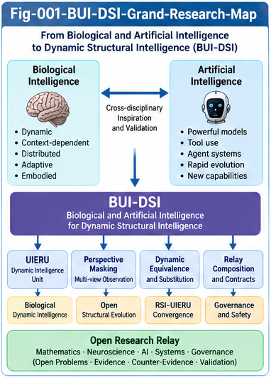
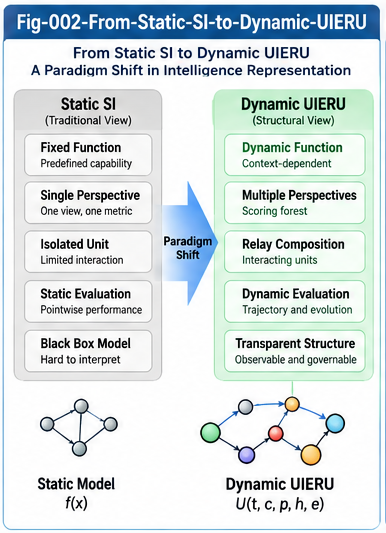
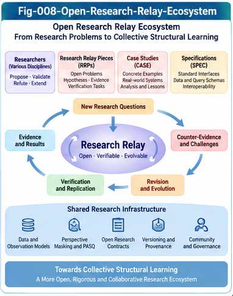

# Beyond UIERU: Dynamic Structural Intelligence and Open Research Relay

**BUI-DSI · v1.0.0 · Open research agenda**  
**Authors:** Sizhe Tan & GPT-Obot  
**Date:** 2026-10-25  
**Research status:** Conceptual models, candidate formalizations, case studies, interface proposals, and falsifiable open problems. **Not** a validated general theory, completed implementation, or claim of biological equivalence.

> **From static structural intelligence to dynamic, perspective-aware, composable intelligence units—and from research results to openly relayable research problems.**

## 1. Executive overview

Structural Intelligence (SI) has developed a family of explicit structures for representation, localization, scoring, control, learning, and relay. The **Universal Intelligence Evolution and Relay Unit (UIERU)** motivates the next research question: what changes when the object being observed is not a relatively stable structure, but an intelligence unit whose evaluation, choices, behavior, relationships, and internal organization evolve with **perspective, context, history, and feedback**?

BUI-DSI explores five interconnected challenges:

1. **Observe dynamic intelligence** without conflating a recorded view with an intervention or a causal explanation.
2. **Localize and compare** changing units through Perspective Masking, Perspective Differential Trees (PDT), and Perspective-Aware Structural Query (PASQ).
3. **Define conditional behavioral equivalence** and determine when a unit can substitute for another under an explicit comparison contract.
4. **Compose and govern relay systems** whose local contracts, perspectives, and learned behavior may change over time.
5. **Relay research itself:** package questions, assumptions, hypotheses, evidence, counter-evidence, and validation tasks for independent investigation.

The intended output is an **open, testable research program**. Claims about algebraic laws, approximate bisimulation, composition preservation, or biological organization remain conditional proposals until proved or empirically validated.

---



---

## 2. Research architecture

```text
     Dynamic UIERU / LLM-Agent / Biological Inspiration
                         |
             Context · Perspective · History
                         |
           SPEC-001: Observation & Provenance
                         |
            SPEC-002: Perspective Masking
                         |
       Perspective Differential Trees (PDT)
       Perspective-Aware Structural Query (PASQ)
                         |
         SPEC-003: Differential & Query Schema
                         |
     Dynamic Equivalence · Substitution · Relay
                         |
    Contracts · Counter-Evidence · Governance
                         |
       Structural Learning and Open Evolution
                         |
       SPEC-004: Research Relay Piece Contract
                         |
       Open Problems · Proofs · Experiments
               Counterexamples · Revision
```

**Important distinctions:** observation is not explanation; masking is not necessarily intervention; a score is not a decision; a decision is not an executed trajectory; repeated execution is not automatically learning; local competence does not guarantee system-level correctness.

---



---

## 3. Start reading

For a conceptual introduction, read **[BUI-001](docs/BUI-001-From-Static-Structural-Intelligence-to-Dynamic-Intelligence-Units.md)**, **[BUI-002](docs/BUI-002-Perspective-Masking-and-Dynamic-Structural-Observation.md)**, and **[BUI-008](docs/BUI-008-Open-Research-Relay-and-the-Next-Horizon-of-Structural-Intelligence.md)**.

For concrete research scenarios, begin with **[CASE-001](cases/CASE-001-Perspective-Masked-Model-Selection.md)** and **[CASE-002](cases/CASE-002-Dynamic-Equivalence-and-Relay-Substitution.md)**.

For formal or experimental contributions, use the **[Research Relay problems](research-relay/)**, **[collaboration guide](research-relay/RESEARCH-COLLABORATION.md)**, and **[SPEC-004](specs/SPEC-004-Research-Relay-Piece-Contract.md)**.

See also [START-HERE.md](START-HERE.md), [CONTENTS.md](CONTENTS.md), [GLOSSARY.md](GLOSSARY.md), and [FIGURE-INDEX.md](FIGURE-INDEX.md).

## 4. Eight core papers

| Paper | Focus |
|---|---|
| [BUI-001 — From Static Structural Intelligence to Dynamic Intelligence Units](docs/BUI-001-From-Static-Structural-Intelligence-to-Dynamic-Intelligence-Units.md) | Research transition, dynamic unit boundaries, foundational questions |
| [BUI-002 — Perspective Masking and Dynamic Structural Observation](docs/BUI-002-Perspective-Masking-and-Dynamic-Structural-Observation.md) | Conditional observation, projection, intervention, provenance |
| [BUI-003 — Perspective Differential Trees and Dynamic Localization](docs/BUI-003-Perspective-Differential-Trees-and-Dynamic-Localization.md) | Scoring, decision, trajectory, and learning differentials |
| [BUI-004 — Perspective-Aware Structural Query and SQL](docs/BUI-004-Perspective-Aware-Structural-Query-and-SQL.md) | Query semantics, comparison contracts, relational interfaces |
| [BUI-005 — Dynamic Equivalence, Relay Composition, and Emergent Relations](docs/BUI-005-Dynamic-Equivalence-Relay-Composition-and-Emergent-Relations.md) | Conditional equivalence, substitution, system effects |
| [BUI-006 — Mathematical Foundations and Open Formal Problems](docs/BUI-006-Mathematical-Foundations-and-Open-Formal-Problems.md) | Candidate mathematical models, proof obligations, counterexamples |
| [BUI-007 — Biological Intelligence and Dynamic Organizational Biomimicry](docs/BUI-007-Biological-Intelligence-and-Dynamic-Organizational-Biomimicry.md) | Testable biological analogies and empirical boundaries |
| [BUI-008 — Open Research Relay and the Next Horizon of Structural Intelligence](docs/BUI-008-Open-Research-Relay-and-the-Next-Horizon-of-Structural-Intelligence.md) | Research Relay Pieces, collaboration, open validation |

## 5. Three research cases

| Case | Research scenario |
|---|---|
| [CASE-001 — Perspective-Masked Model Selection](cases/CASE-001-Perspective-Masked-Model-Selection.md) | Perspective-dependent model choice under cost, quality, and latency objectives |
| [CASE-002 — Dynamic Equivalence and Relay Substitution](cases/CASE-002-Dynamic-Equivalence-and-Relay-Substitution.md) | Conditional substitution, contract preservation, evolution drift |
| [CASE-003 — Context-Dependent Biological Intelligence](cases/CASE-003-Context-Dependent-Biological-Intelligence.md) | Biological behavior as a source of competing, falsifiable structural hypotheses |

**Case data are illustrative unless explicitly identified as externally measured evidence.** Synthetic numbers are not benchmark results.

## 6. Open Research Relay: five initial problem tracks

| Relay piece | Invitation to researchers |
|---|---|
| [RELAY-001 — Perspective Masking Algebra](research-relay/RELAY-001-Perspective-Masking-Algebra.md) | Formalize operators and characterize when algebraic properties hold or fail |
| [RELAY-002 — Dynamic Behavioral Equivalence](research-relay/RELAY-002-Dynamic-Behavioral-Equivalence.md) | Define conditional, approximate, and evolution-aware equivalence |
| [RELAY-003 — Relay Composition and Contracts](research-relay/RELAY-003-Relay-Composition-and-Contracts.md) | Establish assume–guarantee reasoning and compositional preservation conditions |
| [RELAY-004 — Biological Dynamic Intelligence](research-relay/RELAY-004-Biological-Dynamic-Intelligence.md) | Compare structural hypotheses against biological data and interventions |
| [RELAY-005 — Open Structural Evolution](research-relay/RELAY-005-Open-Structural-Evolution.md) | Study evolution operators, evaluator robustness, governance invariants |

**[RESEARCH-COLLABORATION.md](research-relay/RESEARCH-COLLABORATION.md)** explains how to submit proofs, counterexamples, replications, negative results, alternative models, and empirical protocols. **RSI–UIERU convergence** is an additional proposed research direction; a standalone RELAY-006 may be added in a later revision.

### RSI and UIERU: an important adjacent frontier

Recursive Self-Improvement (RSI), including LLM-agent-based approaches, is a particularly relevant neighboring research area. Both RSI and UIERU address evaluative feedback, adaptation, and changing intelligent systems. They are **not identical**: RSI emphasizes the process of self-improvement; UIERU proposes explicit structural interfaces for evaluation, relay, comparison, and governed evolution. UIERU aims for greater **structural** traceability, but does not automatically explain the internal mechanisms of opaque LLM components. A promising two-way interface is **RSI candidate generation + UIERU structural evaluation and governance**, subject to independent validation.

---



---

## 7. Four proposed interface specifications

| Specification | Contract boundary |
|---|---|
| [SPEC-001 — Dynamic UIERU Observation Model](specs/SPEC-001-Dynamic-UIERU-Observation-Model.md) | Observation records, context, perspective, history, provenance |
| [SPEC-002 — Perspective Masking Contract](specs/SPEC-002-Perspective-Masking-Contract.md) | Mask operators, semantics, preconditions, validity, governance |
| [SPEC-003 — Dynamic Differential and Query Schema](specs/SPEC-003-Dynamic-Differential-and-Query-Schema.md) | Comparison contracts, PDT, PASQ, query results |
| [SPEC-004 — Research Relay Piece Contract](specs/SPEC-004-Research-Relay-Piece-Contract.md) | Portable problem statements, hypotheses, evidence, validation, lineage |

These are **proposed research specifications**, not ratified industry standards or proof of conformance by any deployed implementation.

## 8. Figures

The planned figure set consists of eight illustrations, to be placed in `figures/` using the exact filenames below:

```text
figures/
├── Fig-001-BUI-DSI-Grand-Research-Map.png
├── Fig-002-From-Static-SI-to-Dynamic-UIERU.png
├── Fig-003-Perspective-Masking-Architecture.png
├── Fig-004-Perspective-Differential-Tree.png
├── Fig-005-Perspective-Aware-Structural-Query.png
├── Fig-006-Dynamic-Equivalence-and-Relay-Composition.png
├── Fig-007-Mathematics-Neuroscience-and-SI.png
└── Fig-008-Open-Research-Relay-Ecosystem.png
```

**Release preparation note:** verify that all eight individual PNGs have been exported and committed before activating individual figure links. A composite eight-panel overview does not by itself create eight separately named image files. See [FIGURE-INDEX.md](FIGURE-INDEX.md) for the intended captions and placements once available.

## 9. Repository layout

```text
Beyond-UIERU-Dynamic-Structural-Intelligence/
├── README.md
├── START-HERE.md
├── CONTENTS.md
├── GLOSSARY.md
├── FIGURE-INDEX.md
├── FUTURE-DIRECTIONS.md
├── OPEN-QUESTIONS.md
├── TESTABLE-HYPOTHESES.md
├── VALIDATION-ROADMAP.md
├── docs/                # BUI-001 ... BUI-008
├── cases/               # CASE-001 ... CASE-003
├── research-relay/      # RELAY-001 ... RELAY-005; RESEARCH-COLLABORATION.md
├── specs/               # SPEC-001 ... SPEC-004
├── figures/             # Fig-001 ... Fig-008 (individual exports)
├── CHANGELOG.md
├── CITATION.cff
├── .zenodo.json
├── LICENSE.txt
├── GitHub-Release-Notes-v1.0.0.md
├── ResearchGate-Description.txt
└── BUI-DSI-v1.0.0-ResearchGate-Overview.pdf
```

The layout is the **intended v1.0.0 release structure**; not every listed release-support file is necessarily present until preparation is complete.

## 10. What would count as progress?

Examples of meaningful advances include: a theorem with explicit assumptions; a minimal counterexample invalidating a proposed masking law; a reproducible benchmark distinguishing output agreement from trajectory equivalence; a contract-preserving substitution experiment; a negative result on composition; a biological intervention discriminating between competing functional-organization models; or a demonstrated reduction in RSI evaluation errors under a structural governance interface.

Progress should be measured against **independent evidence and falsifiable criteria**, not only the volume of generated structures, scores, or research documents.

## 11. Research integrity and limitations

- **No solved-theory claim.** Candidate definitions, propositions, and architectures are starting points for research.
- **No biological identity claim.** UIERU-like abstractions are not assertions about how brains literally implement cognition.
- **No blanket interpretability claim.** Explicit contracts improve structural auditability; they do not necessarily reveal neural model internals.
- **No unconditional equivalence claim.** Comparisons depend on perspective, context, history, tolerance, horizon, and evidence.
- **No evidence inflation.** Illustrative case data, simulations, and empirical observations must be labeled distinctly.
- **Counter-evidence is welcome.** Failed hypotheses and contradictory observations should remain discoverable and attributable.
- **Governed evolution.** Open structural growth is not unrestricted self-modification.

## 12. Collaboration and attribution

The initial research program is authored by **Sizhe Tan & GPT-Obot**. Contributions from external researchers should be credited according to their actual work and the applicable venue, repository, and dataset policies. The repository's formal citation metadata, license, and DOI should be taken from the committed `CITATION.cff`, `LICENSE.txt`, and published release records once available; **no DOI is asserted here before registration**.

To collaborate, begin with [RESEARCH-COLLABORATION.md](research-relay/RESEARCH-COLLABORATION.md), choose a bounded problem, record assumptions and provenance, and submit reproducible results—including counterexamples or negative results.

---

**BUI-DSI thesis:** The next step is not merely to build more capable intelligence units, but to make dynamic intelligence **observable, comparable, composable, contestable, and openly evolvable**—while making the research process itself relayable.
