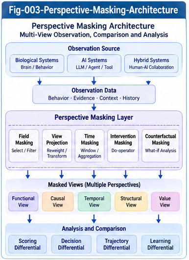

# BUI-002 — Perspective Masking and Dynamic Structural Observation

**Project:** Beyond UIERU: Dynamic Structural Intelligence and Open Research Relay (BUI-DSI)  
**Authors:** Sizhe Tan & GPT-Obot  
**Version:** 1.0.0 — Research proposal  
**Date:** 2026-10-25  
**Status:** Open research agenda; candidate models and engineering contracts, not established universal results

## Abstract

The Universal Intelligence Evolution and Relay Unit (UIERU) shifts Structural Intelligence (SI) research from relatively static, indexable components toward units whose evaluation, decisions, interactions, and internal organization may change with perspective, context, environment, and history. Existing localization mechanisms from the Structural Intelligence Framework (SIF) remain useful when a dynamic unit is viewed through stable structural attributes, but observing its live scoring and adaptation requires additional methodological discipline. This paper proposes **Perspective Masking** as a family of explicitly scoped observation and intervention operators, rather than a single operation that simply hides a scoring forest. It develops a minimal dynamic-unit model; distinguishes structural projection, observational filtering, execution intervention, and counterfactual reconstruction; defines masking contracts and provenance; examines algebraic properties and their failure modes; and proposes a practical observation architecture. The central objective is to recover comparable, queryable structural views without confusing a masked view with the behavior of the unmasked system. The paper closes with testable hypotheses, counterexamples, and an open research relay interface for mathematics, neuroscience, and engineering.

**Keywords:** UIERU; dynamic structural intelligence; perspective masking; observation semantics; scoring forest; localization; intervention; provenance; temporal state; counter-evidence; structural relay

## 1. Introduction: The Observation Problem After UIERU

Static SI tools typically assume that a useful portion of the research object can be represented as a relatively stable structure: a differential tree, a capability index, a contract, a name–type registry, or a calling graph. A dynamic UIERU, by contrast, may change the selected action when its perspective changes, update its internal state after feedback, and alter its relay partners or scoring configuration. The same unit can consequently present different observable behavior at different times even when its structural identifier remains unchanged.

The research question is not simply how to inspect more fields. It is how to **construct controlled, meaningful views** of a dynamic unit so that SIF localization and differential analysis can be extended without making invalid comparisons. Masking offers one candidate mechanism: restrict the dimensions being observed or varied while explicitly recording what was excluded.

This paper treats masking as a research instrument. It is not assumed to preserve decisions, eliminate uncertainty, or expose the true internal causes of observed behavior.

## 2. Minimal Dynamic Observation Model

Represent a UIERU abstractly as

\[
U=(I,K,X,\mathcal P,\mathcal A,S,T,R,L),
\]

where:

- \(I\): identity and version metadata;
- \(K\): structural core, including capabilities, contracts, and interface descriptions;
- \(X\): internal state space;
- \(\mathcal P\): supported perspective space;
- \(\mathcal A\): candidate actions and delegations;
- \(S\): scoring or valuation mechanism, potentially a forest of operators;
- \(T\): transition mechanism for state and action consequences;
- \(R\): relay and interaction interfaces;
- \(L\): learning or structural evolution mechanism.

A discrete-time model, offered for tractability rather than biological fidelity, is

\[
(a_t,y_t)=\pi_U(x_t,p_t,c_t,e_t;\theta_t),
\]

\[
x_{t+1}=T_U(x_t,a_t,e_t,f_t;\theta_t),\qquad
\theta_{t+1}=L_U(\theta_t,x_t,a_t,f_t),
\]

where \(p_t\) is perspective, \(c_t\) context, \(e_t\) environment, \(f_t\) feedback, \(\theta_t\) evolving structural parameters, and \(y_t\) observable outputs. The model allows stochastic mechanisms by interpreting \(\pi_U,T_U,L_U\) as probability kernels.

A **trace** is a time-indexed record of selected observable fields, for example

\[
\tau=(I,t,p_t,c_t,\widehat x_t,a_t,y_t,f_t,r_t,\nu_t)_{t=0}^{n},
\]

with \(r_t\) relay events and \(\nu_t\) version identifiers. The hat on \(\widehat x_t\) denotes a partial or estimated state, not privileged access to the true state.

## 3. What Is a Perspective?

A perspective is a declared evaluation standpoint: a choice of objectives, constraints, weights, priorities, risk tolerances, or relevant evidence. It need not be reducible to a scalar weight vector. For example, cost-first, quality-first, and latency-first model-selection perspectives may differ both in their scoring weights and in hard admissibility constraints.

We distinguish:

1. **Declared perspective:** the policy or scoring standpoint supplied to the system.
2. **Effective perspective:** the standpoint actually enacted after control rules, context, and hidden state interact.
3. **Inferred perspective:** a researcher's estimate based on observed decisions.

These three must not be silently equated. A masked experiment should record which notion it uses. Perspective is also distinct from context: a medical safety constraint and a time-of-day signal may affect the same decision through different mechanisms.

## 4. Four Masking Semantics

The word *mask* is dangerously ambiguous unless its operational meaning is specified.

### 4.1 Structural projection

A projection \(M^{\mathrm{proj}}_F\) selects fields \(F\) from a fixed representation or recorded trace:

\[
M^{\mathrm{proj}}_F(\tau)=\tau|_F.
\]

It does not rerun the UIERU or alter the historical decision. This is the closest extension of traditional SIF structural localization.

### 4.2 Observational filtering

An observational mask \(M^{\mathrm{obs}}_q\) selects recorded episodes satisfying predicate \(q\), such as a perspective class or time window. Filtering changes the population of observations and may introduce selection bias; it does not show what the same unit *would have done* under a different perspective.

### 4.3 Execution intervention

An intervention \(M^{\mathrm{do}}_{p\leftarrow p^*}\) changes an input, policy, or scoring component during a new run. It may change the selected action, downstream environment, feedback, and future state. Such a mask is an **experiment**, not a passive view. For an intervention on a scoring subtree, the system must declare how removed contributions are handled (zeroed, renormalized, replaced, or prohibited).

### 4.4 Counterfactual reconstruction

A counterfactual mask asks what would have occurred under a hypothetical change while holding specified exogenous conditions fixed. This requires a causal or generative model and explicit identification assumptions. Counterfactual outputs are estimates, not observed facts; model uncertainty must be reported.

**Core rule:** Never compare the output of a historical projection with an intervention or counterfactual result as though all three had identical evidential status.

## 5. A Practical Mask Taxonomy

| Mask | Controlled or displayed dimension | Primary use | Principal risk |
|---|---|---|---|
| Structural | Interfaces, contracts, capabilities, versions | Static localization | Missing dynamic dependencies |
| Perspective | Declared objectives, priorities, constraints | Perspective comparison | Unobserved effective perspective |
| Scoring | Operators, trees, normalization rules | Attribution and ablation | Altered rankings and scale |
| Context | Task and situation descriptors | Matched comparisons | Context mismatch or confounding |
| Temporal | Time interval, state snapshot, history | Evolution tracking | State drift and stale snapshots |
| Evolution | Learning updates and structural changes | Controlled replay | Nonrepresentative frozen behavior |
| Interaction | Relay partners, messages, shared resources | Composition analysis | Network effects and feedback loss |
| Evidence | Provenance, confidence, source categories | Robustness and counter-evidence | Biased omission |

Masks may be composed, but composition is meaningful only when the corresponding semantics and admissible inputs are defined. A frozen-evolution run is not equivalent to merely hiding evolution fields in a log.

---



---

## 6. Observation Views and the SIF Bridge

Define an observation request as

\[
q=(U,\mathcal P_q,\mathcal C_q,[t_0,t_1],m,\sigma),
\]

where \(m\) is a mask specification and \(\sigma\) an observation semantics tag. Its result is

\[
V_q=(D_q,\Gamma_q,\Omega_q),
\]

where \(D_q\) contains selected data, \(\Gamma_q\) provenance and experimental conditions, and \(\Omega_q\) limitations or uncertainty.

A useful engineering split is:

- **Stable descriptor plane:** names, types, capability contracts, structural signatures, ownership, version lineage.
- **Dynamic evidence plane:** perspective-labeled scoring observations, choices, trajectories, feedback, and evolution events.
- **Query and comparison plane:** localization indexes, differential trees, SQL/graph/temporal queries, and matched-episode analysis.
- **Governance plane:** access controls, evidence quality, counter-evidence, and reproducibility checks.

This preserves the investment in SIF localization while preventing dynamic traces from being mistaken for immutable structural properties. A unit can be located by its contract and then compared through scoped behavioral evidence.

## 7. Candidate Algebra of Masking

Mathematical structure depends on mask semantics. For pure field projection onto sets \(F\) and \(G\), under a common immutable representation,

\[
M_F^{\mathrm{proj}}\circ M_G^{\mathrm{proj}}=M_{F\cap G}^{\mathrm{proj}},
\]

and therefore projection is idempotent and commutative under these assumptions. This is a standard property of projection, not a novel UIERU theorem.

For interventions, analogous identities generally fail. If one intervention changes the score normalization and another freezes learning, their order can affect decisions and future state:

\[
M_A^{\mathrm{do}}\circ M_B^{\mathrm{do}}\ne
M_B^{\mathrm{do}}\circ M_A^{\mathrm{do}}.
\]

Research questions include: Which restricted intervention families commute? Can a typed mask calculus reject invalid compositions? What properties of the original system survive masking? Can mask-induced changes be bounded?

We should distinguish **view equivalence**, **decision preservation**, **trajectory preservation**, and **contract preservation**. Equality of visible fields implies none of the latter three without additional assumptions.

## 8. Differential Observation Across Perspectives

Given matched runs under perspectives \(p_i\) and \(p_j\), a candidate differential record is

\[
\Delta_{ij}=(\Delta S,\Delta A,\Delta\tau,\Delta L;\Gamma),
\]

where the components denote scoring differences, decision differences, trajectory differences, and learning/evolution differences; \(\Gamma\) records matching assumptions and provenance.

A simple score difference \(S(U,p_i)-S(U,p_j)\) is interpretable only when score scales, candidate sets, and normalization are comparable. For heterogeneous scoring forests, rank changes, pairwise preference reversals, or calibrated outcome measures may be more defensible than raw subtraction.

A Perspective Differential Tree can organize common conditions at the trunk and branch by verified differences. The tree should retain *unknown* and *not comparable* states instead of forcing every observation into an apparent match or mismatch. Detailed tree design is developed in BUI-003.

## 9. Illustrative Case: Model Selection

Consider a UIERU choosing among models A, B, and C for a coding task. The available choices, test inputs, tool budget, and model versions are held fixed for an experiment.

- Under cost-first perspective \(p_C\), the unit chooses A.
- Under quality-first perspective \(p_Q\), it chooses B.
- Under latency-first perspective \(p_L\), it chooses C.

These are **illustrative hypothetical observations**, not benchmark findings.

A structural mask may show that all three runs share the same capability contract. A perspective-filtered historical view may report the three decisions. A scoring-tree intervention might suppress one valuation component and produce a fourth result. A counterfactual model may predict a different decision without executing it. Each output requires a distinct label.

The resulting research question is not merely whether choices differ, but which differences remain after controlling for task, state, environment, and history—and whether those differences propagate through Relay and feedback.

## 10. A Perspective Masking Contract

A minimal interoperable mask specification should declare:

```yaml
mask_id: example-perspective-cost-v1
unit_id: example-uieru-01
unit_version: v1
semantics: observational_filter  # projection | observational_filter | intervention | counterfactual
perspective:
  declared_id: cost-first
context_scope:
  task_family: coding
state_scope:
  policy: recorded_state
history_scope:
  start: example-start
  end: example-end
included_fields:
  - selected_capability
  - declared_perspective
  - decision_timestamp
excluded_fields:
  - internal_private_state
score_comparability: not_asserted
provenance_required: true
uncertainty_status: observational_only
```

This YAML is a proposed schema sketch, not an implemented standard. A production contract also needs permission rules, stable identifiers, clock conventions, version hashes, missing-data semantics, intervention reproducibility, and privacy safeguards.

## 11. Observation Pipeline and MET Architecture

A candidate implementation path is:

1. **Discover** UIERU by stable name–type, capability, and contract metadata.
2. **Specify** a typed mask with explicit observation semantics.
3. **Capture** events and relevant state/version snapshots, or schedule controlled experimental runs.
4. **Normalize** only comparable fields; preserve raw evidence and original scoring units.
5. **Index** structural descriptors separately from dynamic episodes.
6. **Compare** matched episodes using perspective-aware differential analysis.
7. **Query** through relational, graph, or temporal views with provenance.
8. **Challenge** candidate regularities using counterexamples and adversarial contexts.
9. **Relay** the observation package, assumptions, limitations, and replication procedure.

Repeated execution can itself be a data-accumulating Relay mechanism, but repeated samples are not automatically independent. Autocorrelation, learning drift, and shared environments must be handled explicitly.

## 12. Failure Modes and Counter-Evidence

**Mask-induced policy change.** Removing a scoring subtree changes normalization and reverses action ranking. Remedy: label as intervention; compare against the original policy and record normalization semantics.

**Hidden-state confounding.** Two perspective groups differ in prior experience. Remedy: matched state snapshots, randomization where feasible, or explicit observational limitations.

**Temporal nonstationarity.** A unit learns during the study, invalidating comparisons across time. Remedy: versioned state and temporal stratification; avoid claiming a single stationary behavior model.

**Selection bias.** Query filters retain only successful episodes. Remedy: include failures, abstentions, and counter-evidence in the observation contract.

**False structural equivalence.** Two units expose identical contracts but respond differently under stress. Remedy: treat contract matching as a localization filter, not a behavioral proof.

**Unobservable internal causes.** Similar decisions may arise from different mechanisms. Remedy: state the identifiability limits and do not infer a unique internal scoring forest from outputs alone.

**Biological over-analogy.** Context-dependent neural behavior is described as literal UIERU masking. Remedy: keep functional analogies separate from neurobiological claims; seek independent experimental evidence.

## 13. Mathematical and Biological Research Interfaces

For mathematics and theoretical computer science, open tasks include typed mask algebras, observational equivalence, causal identifiability, compositional reasoning, and error bounds for approximate dynamic views.

For computational neuroscience, the relevant question is whether perspective-dependent changes in neural population dynamics can be modeled through comparable observation operators without implying that biological circuits implement a literal scoring forest. Task switching, state-dependent behavior, and changing functional assemblies are candidate comparison domains, not confirmation of the UIERU architecture.

For engineering, the immediate opportunity is to build a small provenance-preserving view layer over recorded UIERU-like decisions and test whether it improves localization, debugging, and substitution analysis compared with static metadata alone.

## 14. Testable Hypotheses

**H1 — Reusable static descriptors.** For a bounded class of UIERUs, stable contract and capability metadata can retain useful SIF localization performance even when behavioral policy varies. *Test:* compare contract-based retrieval with fully dynamic retrieval across controlled state changes.

**H2 — Mask semantics reduce false conclusions.** Explicitly distinguishing projection, filtering, intervention, and counterfactual inference reduces invalid behavioral-equivalence claims. *Test:* blinded analyst studies or benchmark evaluations with seeded confounders.

**H3 — Differential views add diagnostic value.** Perspective-labeled decision and trajectory differences detect meaningful policy changes missed by static descriptors. *Test:* controlled ablations with known policy shifts and measured detection precision/recall.

**H4 — Provenance improves reproducibility.** Versioned state, context, and scoring metadata increase the reproducibility of masked comparisons. *Test:* independent reruns under documented conditions; report residual variation.

**H5 — Typed composition prevents invalid masks.** A typed masking contract can reject at least some invalid combinations before execution. *Test:* construct a suite of legal/illegal mask compositions and evaluate detection coverage.

These are hypotheses, not demonstrated results.

## 15. Open Questions

1. Which dynamic-unit properties are invariant under purely observational masks?
2. Under what conditions can masked observations support valid substitution decisions?
3. Can scoring contributions be meaningfully compared across heterogeneous forests?
4. How should unknown, missing, private, and counterfactual evidence be represented distinctly?
5. What minimal state snapshot makes an intervention reproducible?
6. Which classes of masks admit associative, commutative, or idempotent composition?
7. Can mask-aware localization be efficient without discarding important history?
8. How do relay partners and feedback loops change the interpretation of a local mask?
9. How should dynamically changing unit boundaries be represented?
10. What would falsify the claim that perspective masking is a useful general-purpose MET primitive?

## 16. Open Research Relay Package

A portable contribution addressing any question in this paper should include:

- **Problem and scope:** unit class, context, perspective, and temporal range.
- **Semantics:** whether evidence comes from projection, filtering, intervention, or counterfactual modeling.
- **Formal model:** definitions, assumptions, and claimed invariants.
- **Evidence:** data, traces, code or pseudocode, and provenance when shareable.
- **Counter-evidence:** failure cases, confounders, and unresolved limitations.
- **Validation:** replication protocol and acceptance/falsification criteria.
- **Interfaces:** relationships to BUI-003 differential trees, BUI-004 structural query, and BUI-006 mathematical foundations.

Negative findings and proofs of impossibility are legitimate research relay outcomes. No contributor must endorse UIERU as a universal or biologically literal intelligence unit to participate.

## 17. Relationship to the BUI-DSI Series

- **BUI-001:** motivates the transition from static structural research to dynamic intelligence units.
- **BUI-002 (this paper):** defines the observation and masking problem, its semantics, and evidence contract.
- **BUI-003:** develops perspective differential trees and dynamic localization.
- **BUI-004:** develops perspective-aware structural query and SQL interfaces.
- **BUI-005:** examines dynamic equivalence, relay composition, and emergent relations.
- **BUI-006:** formulates mathematical foundations and open formal problems.
- **BUI-007:** studies biological intelligence and dynamic organizational biomimicry.
- **BUI-008:** develops open research relay and the next research horizon.

## 18. Conclusion

Perspective Masking is proposed as a disciplined way to observe and experimentally probe dynamic intelligence units while retaining the value of SIF's structural localization mechanisms. Its essential advance is not the ability to hide fields, but the explicit separation of what was observed, what was changed, what was inferred, and what remains unknown. The next research step is to formalize mask semantics and test whether provenance-preserving differential views yield reusable, trustworthy MET tools across heterogeneous UIERUs. The proposal is intentionally open to refinement, counterexamples, and replacement by better models.

---

**Citation note:** Cite this manuscript as a conceptual research proposal within the BUI-DSI v1.0.0 series. No experimental validation or universal mathematical theorem is claimed here. External related-work references and a systematic prior-art review should be incorporated as the research program matures.

**Authors:** Sizhe Tan & GPT-Obot  
**Project:** Beyond UIERU: Dynamic Structural Intelligence and Open Research Relay  
**License:** See repository `LICENSE.txt`.
