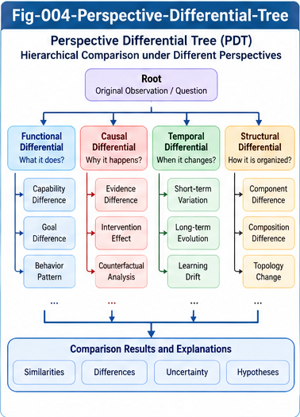

# BUI-003 — Perspective Differential Trees and Dynamic Localization

**Beyond UIERU: Dynamic Structural Intelligence and Open Research Relay (BUI-DSI)**  
**Version:** 1.0.0 — Research proposal  
**Authors:** Sizhe Tan & GPT-Obot  
**Status:** Open research agenda; definitions and hypotheses are provisional

## Abstract

Static structural localization retrieves intelligence assets by descriptors, capabilities, contracts, and graph position. Dynamic intelligence units, such as the proposed Universal Intelligence Evolution and Relay Unit (UIERU), additionally vary with perspective, context, internal state, history, and interaction. This paper proposes **Perspective Differential Trees (PDTs)** as provenance-preserving representations of differences among controlled observations of dynamic intelligence units. It distinguishes score, decision, trajectory, and learning differentials; develops a staged dynamic-localization architecture; defines comparison contracts and candidate operators; and outlines falsifiable experiments. A PDT is not assumed to be a unique causal explanation, a complete behavioral model, or a proven universal data structure. Its utility must be evaluated against simpler baselines.

**Keywords:** structural intelligence; UIERU; perspective masking; differential tree; dynamic localization; scoring forest; trajectory; counter-evidence; research relay.

---



---

## 1. Motivation: From Structural Addressing to Behavioral Addressing

The Structural Intelligence Framework (SIF) supplies a vocabulary for locating and connecting capabilities, contracts, precedents, and executable intelligence structures. These tools can often address the relatively stable part of a UIERU. Yet a structurally identical unit can choose different actions under different goals, contexts, histories, and available resources. A static descriptor alone therefore does not determine suitability for a task.

The central question is:

> How can a localization system find, compare, and select dynamic intelligence units by the behavior they exhibit under explicitly specified conditions, without claiming to know their complete internal mechanisms?

This paper investigates a candidate answer: pair stable structural indexing with conditional behavioral evidence and organize differences as perspective-aware differential trees.

## 2. Scope and Epistemic Status

This is a **research proposal**, not a report of completed experiments. The terms UIERU, PDT, and dynamic localization refer to proposed engineering abstractions. Mathematical notation is used to make assumptions testable, not to imply that the proposed operators have already been shown to possess desirable algebraic properties.

The proposed tree representation may be insufficient when dependencies are cyclic, temporal, or strongly interacting. In those cases a DAG, event graph, or relational representation may be necessary. A tree can still serve as a navigational view over richer evidence.

## 3. A Minimal Dynamic Observation Model

Let a dynamic intelligence unit be described by a stable structural descriptor \(D_U\) and an evolving internal state \(x_t\). Let \(p_t\) denote a perspective or evaluation configuration, \(c_t\) task context, \(e_t\) environment, \(r_t\) incoming relay information, and \(h_t\) relevant history. A provisional transition model is

\[
(a_t,y_t,x_{t+1}) \sim K_U(\cdot\mid x_t,p_t,c_t,e_t,r_t,h_t),
\]

where \(a_t\) is a selected action and \(y_t\) an observable outcome. The stochastic kernel accommodates deterministic systems as a special case. History may be summarized in state only if an adequate state representation exists; otherwise the model must retain explicit history dependence.

An observation record is

\[
o=(u,v,t,p,c,e,h,r,m,q,s,a,y,\tau,\pi),
\]

where \(u\) is unit identity, \(v\) version, \(m\) mask specification, \(q\) candidate set, \(s\) available score data, \(\tau\) trajectory trace, and \(\pi\) provenance. Not all fields need be visible; missingness must be represented rather than silently imputed.

## 4. Comparison Contracts: What Must Be Held Constant?

A perspective differential is meaningful only relative to a **comparison contract**. At minimum, the contract should specify:

- unit and version identity, including changes between observations;
- task definition, candidate set, and available tools;
- context and environment matching or stratification;
- initial state or an explicit state-distribution assumption;
- history window and prior learning exposure;
- perspective semantics, weights, and score normalization;
- observational versus intervention masking;
- randomness control, repeated trials, and uncertainty estimates;
- outcome metrics, safety constraints, and trace completeness.

Changing perspective while holding these factors fixed supports a controlled comparison. When such control is infeasible, comparisons must be labeled observational and potential confounding explicitly reported.

## 5. Perspective Masking as a View Operator

Write \(M_{p,m}(\mathcal O_U)\) for a view of observations \(\mathcal O_U\) filtered or projected under perspective \(p\) and mask \(m\). This **observational mask** does not alter the running unit. In contrast, \(I_{p,m}(U)\) denotes an **intervention** that may change scoring, action, feedback, or state transitions. A third operation, counterfactual reconstruction, estimates unobserved outcomes and requires explicit model assumptions.

These operations must not be conflated. In particular, an observational view may be idempotent under stable selection semantics while an intervention may not be. Nor does an equality between masked observations establish equality of the unmasked systems.

## 6. Four Levels of Dynamic Differential

### 6.1 Scoring differential

For comparable candidates \(k\), define

\[
\Delta S_k(p_i,p_j\mid z)=S_U(k,p_i\mid z)-S_U(k,p_j\mid z),
\]

where \(z\) denotes the fixed comparison conditions. This subtraction requires scores to share a calibrated scale. Otherwise rank changes, pairwise preferences, or normalized distributions are safer comparisons.

### 6.2 Decision differential

Define \(\Delta A\) as a relation between actions selected under two perspectives. It can encode same/different choice, top-\(k\) overlap, action distance, or a divergence between action distributions. Score differences need not produce decision differences.

### 6.3 Trajectory differential

For trajectories \(\tau_i\) and \(\tau_j\), define

\[
\Delta T=d_{\tau}(\tau_i,\tau_j\mid z),
\]

where \(d_{\tau}\) is a declared comparison function: event edit distance, aligned state divergence, outcome regret, or temporal-logic property mismatch. Different metrics capture different notions of behavioral difference; no universal metric is assumed.

### 6.4 Learning and evolution differential

For state or structure update operators \(L_U\), compare the post-experience states or their future observable behavior:

\[
\Delta L=d_L\big(L_U(x,p_i,\xi_i),L_U(x,p_j,\xi_j)\big).
\]

If internal states are inaccessible, use future probe tasks to estimate a behavioral change instead. Learning differentials must distinguish exposure differences from update-mechanism differences.

## 7. Candidate Perspective Differential Tree (PDT)

A PDT is a **hierarchical index of conditional differences**, not necessarily a causal decision tree. One possible hierarchy is:

```text
Comparison contract: unit/version + task + state/environment assumptions
└── Perspective contrast: P_cost versus P_quality
    ├── Score differential
    │   ├── Candidate A: calibrated score shift
    │   └── Candidate B: ranking reversal
    ├── Decision differential
    │   └── Selected capability changes A → B
    ├── Trajectory differential
    │   ├── Tool calls and latency
    │   └── Outcome quality and constraint violations
    └── Learning differential
        ├── Updated preference evidence
        └── Changed performance on future probe tasks
```

Each node should carry its measurement definition, sample count, uncertainty, provenance links, comparison contract, and counter-evidence. The hierarchy supports navigation and retrieval even when underlying observations are stored in a graph or event database.

## 8. Tree Construction and Update

A candidate PDT construction procedure is:

1. Register the UIERU structural descriptor and versioned comparison contract.
2. Select a perspective contrast and decide whether to observe or intervene.
3. Collect paired or appropriately matched traces, preserving raw records.
4. Validate score comparability and missing-data assumptions.
5. Compute score, decision, trajectory, and learning differentials where supported.
6. Group differences by interpretable mechanisms and task dimensions.
7. Attach confidence intervals, contradictory traces, and provenance.
8. Index the resulting views; revise or split nodes as new evidence arrives.

A tree update should be append-auditable: earlier evidence is not silently overwritten by a newer summary. Structural version changes trigger revalidation of affected comparisons.

## 9. Dynamic Localization Architecture

A practical system can separate four planes:

**Stable descriptor plane:** SIF-style names, types, capabilities, contracts, ownership, versions, and relay interfaces.

**Dynamic evidence plane:** perspective-tagged runs, state summaries, scores, choices, trajectories, learning probes, and counter-evidence.

**Differential index plane:** PDT views, conditional similarity signatures, coverage metadata, and provenance links.

**Governance plane:** comparison validity, access control, evaluator definitions, safety constraints, and evidence quality.

The localization process first narrows candidates by stable capabilities and contracts, then ranks or filters them by relevant conditional behavior. This avoids treating expensive dynamic evaluation as the first retrieval step for every query.

## 10. Example Localization Questions

A dynamic localization service could ask:

- Which units satisfy a tool-use contract **and** retain acceptable quality under a cost-oriented perspective?
- Which units change their selected capability when the perspective changes from latency to reliability?
- Which units exhibit low trajectory variance across a specified set of contexts?
- Which candidates have supporting evidence for safe substitution, and where are the counterexamples?
- Which unit versions changed their behavior after feedback, even though their public capability descriptors stayed constant?

These are conditional questions. Answers must return coverage limits and evidence provenance, not only a ranked list.

## 11. Worked Example: Model Selection Under Three Perspectives

Consider a hypothetical UIERU choosing among models A, B, and C for a coding task. Three perspectives emphasize cost, quality, and latency. Suppose controlled trials find that A is chosen most often under cost, B under quality, and C under latency. This example is **illustrative**, not empirical evidence.

A PDT would record the common task and candidate set, perspective-specific score definitions, choice frequencies, downstream task outcomes, and uncertainty across repeated trials. If quality-oriented runs use harder prompts, the contract fails: apparent perspective differences could instead reflect task differences. The appropriate response is to stratify or rerun the comparison, not to publish an unqualified differential.

## 12. Differential Trees Versus Alternative Representations

PDTs should be compared with flat feature vectors, relational event tables, graph indexes, sequence embeddings, and conventional decision trees. Trees are interpretable and support hierarchical navigation, but can duplicate evidence and obscure many-to-many dependencies. A hybrid architecture may use event logs as the source of truth, relational queries for filtering, and PDTs as materialized explanatory indexes.

The criterion is measurable retrieval and analysis utility, not aesthetic preference for trees.

## 13. Connection to Perspective-Aware Structural Query

PDT nodes should be addressable by a query layer rather than confined to static diagrams. A future Perspective-Aware Structural Query (PASQ) interface might filter by `perspective_id`, `comparison_contract_id`, `difference_type`, `evidence_window`, `confidence_method`, and `unit_version`.

The following SQL is schematic; it presumes a database schema defined elsewhere:

```sql
SELECT unit_id, comparison_contract_id, difference_type, effect_size
FROM perspective_differentials
WHERE perspective_a = 'cost'
  AND perspective_b = 'quality'
  AND difference_type = 'decision'
  AND evidence_status = 'validated';
```

`validated` must denote a documented review protocol, not an assertion that the result is universally true. BUI-004 develops the query perspective in greater detail.

## 14. Dynamic Equivalence and Substitution

A small differential over selected perspectives may support **bounded behavioral similarity**, but not universal equivalence. Define a conditional distance

\[
d_{\mathcal P,\mathcal C,H}(U,V)
=\mathbb E_{z\sim\mu}\left[d_B(B_U(z),B_V(z))\right],
\]

for a declared test distribution \(\mu\) and behavioral metric \(d_B\). The result depends on sampling, coverage, and observability. Low average distance does not guarantee safety on rare but critical contexts. Worst-case constraints and explicit counterexample searches may be required before relay substitution.

## 15. Mathematical Questions

1. Under which assumptions can masking and differential extraction be composed without changing their meaning?
2. When do PDT summaries preserve the distinctions needed for downstream localization?
3. Can an approximate behavioral distance support sound substitution guarantees under explicit contracts?
4. How should temporal alignment and partially observed state be handled in trajectory comparison?
5. Can a hierarchical index remain stable as unit structure, perspectives, and scoring scales evolve?
6. Which differential summaries are sufficient for retrieval, and which require full trace access?

These questions connect to transition systems, probabilistic bisimulation, abstract interpretation, database provenance, causal inference, and temporal logic; identifying genuinely novel results requires a dedicated literature review.

## 16. Counter-Evidence and Failure Modes

Candidate failure modes include score-scale mismatch, unobserved context shifts, hidden history dependence, stochastic variance, feedback-induced nonstationarity, selective logging, masked-out safety dependencies, and false equivalence from sparse tests. An adversarial evaluation should actively seek examples where a PDT indicates similarity but downstream behavior differs materially.

Every differential claim should be accompanied by a statement of **what has not been tested**.

## 17. Validation Roadmap

**Experiment A — Controlled perspective switching.** On fixed tasks and candidate sets, test whether PDTs faithfully summarize observed scoring and action differences. Measure trace fidelity and uncertainty calibration.

**Experiment B — Localization utility.** Compare static-only retrieval, flat dynamic features, and PDT-augmented retrieval on held-out task/perspective queries. Measure retrieval precision, contract violations, latency, and computational cost.

**Experiment C — Nonstationary learning.** Introduce controlled feedback updates and test whether versioned PDTs detect meaningful changes without excessive false alarms.

**Experiment D — Adversarial substitution.** Select apparently similar units, then search for rare contexts that violate equivalence or relay contracts. Record failures as first-class research outputs.

Pre-register evaluation criteria where practical. Distinguish synthetic demonstrations from evidence on real systems.

## 18. Testable Hypotheses

**H1.** Under a fixed evaluation budget, PDT-augmented localization improves retrieval for perspective-conditional queries over static-descriptor-only retrieval.

**H2.** Explicit comparison contracts reduce false differential findings caused by context and candidate-set confounding.

**H3.** Multi-level score/decision/trajectory differentials identify behavior changes missed by score-only monitoring.

**H4.** Provenance-linked counter-evidence reduces unjustified substitution recommendations relative to similarity-only retrieval.

**H5.** For at least some application classes, a hierarchical PDT index provides better human interpretability at acceptable retrieval overhead than flat dynamic features.

All hypotheses are empirical and may be rejected. A negative result should update the research program rather than be concealed.

## 19. Research Relay Interfaces

This paper offers several independently reusable pieces:

- **Comparison Contract:** assumptions required for meaningful perspective comparisons.
- **Differential Record:** typed score, decision, trajectory, or learning difference with provenance.
- **PDT View:** hierarchical index over validated differential records.
- **Localization Query:** task and perspective constraints plus evidence coverage requirements.
- **Counterexample Package:** reproducible conditions where a differential claim fails.

Future work should publish machine-readable schemas and benchmark datasets with appropriate privacy and access controls. Proposed follow-on documents include BUI-004 (Perspective-Aware Structural Query), BUI-005 (Dynamic Equivalence and Relay Composition), and the repository's formal specifications.

## 20. Conclusion

The move from static structural intelligence to dynamic intelligence units creates a new localization challenge: the same unit can exhibit different capabilities and outcomes under different perspectives, states, and histories. Perspective Differential Trees are proposed as a navigable, evidence-linked representation of these conditional differences. Their value will depend on rigorous comparison contracts, explicit uncertainty, adversarial counterexamples, and empirical advantage over simpler indexing methods. The goal is not to declare dynamic intelligence solved, but to make its emerging problems **visible, structured, testable, and openly relayable**.

## Research Lineage and Related Work Directions

This work is part of the BUI-DSI research agenda following the proposed SI structures MDT, CCC, UTN, PIRP/PIRU, UCPSF, SIF, and UIERU. It draws conceptual motivation from, but does not claim priority over, existing work on state-transition systems, contextual decision-making, system identification, temporal databases, causal inference, probabilistic bisimulation, and explainable retrieval. A systematic citation review is needed before publication of any novelty claim.

## Citation and Reuse Note

**Suggested citation (pending DOI):** Tan, Sizhe, and GPT-Obot. *BUI-003: Perspective Differential Trees and Dynamic Localization*. In *Beyond UIERU: Dynamic Structural Intelligence and Open Research Relay*, version 1.0.0, 2026. Repository DOI to be added after release.

Contributions, formal corrections, counterexamples, and alternative representations are welcome. Please preserve attribution and distinguish established results from hypotheses.
