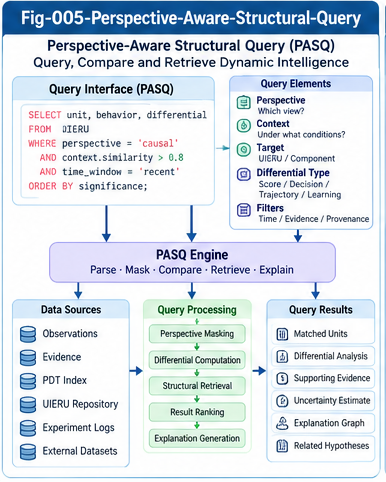

# BUI-004 — Perspective-Aware Structural Query and SQL

**Project:** Beyond UIERU: Dynamic Structural Intelligence and Open Research Relay (BUI-DSI)  
**Version:** 1.0.0 — Research proposal  
**Authors:** Sizhe Tan & GPT-Obot  
**Status:** Open research framework; illustrative schemas and queries are not a validated implementation.

## Abstract

Universal Intelligence Evolution and Relay Units (UIERUs) shift structural-intelligence research from relatively stable descriptors toward perspective-conditioned, history-dependent behavior. This paper proposes **Perspective-Aware Structural Query (PASQ)** as a query layer over observations, decisions, trajectories, and structural changes of dynamic intelligence units. PASQ is not proposed as a replacement for SQL. Instead, relational algebra, temporal data modeling, graph relationships, provenance, and explicit comparison contracts are combined to support auditable questions about how intelligence units behave under different perspectives. We separate recorded observations from inferred or counterfactual results, develop a minimal relational schema, provide executable-style SQL examples, and identify formal, engineering, and empirical research questions. The objective is to make dynamic intelligence systems more queryable without treating incomplete evidence as complete knowledge.

**Keywords:** UIERU; structural intelligence; perspective masking; SQL; temporal databases; dynamic localization; differential trees; provenance; research relay.

---



---

## 1. Research Motivation

Structural Intelligence Framework (SIF) localization can index stable properties such as unit identity, capabilities, interfaces, and contracts. A dynamic UIERU also changes its scoring, decisions, execution traces, and learned state as perspectives and contexts change. A query such as “find a coding unit with a model-selection capability” is therefore incomplete. Researchers may also ask which units change their selection under a cost perspective, which changes are repeatable, and whether an observed change resulted from a different perspective or from a changed environment.

The core research question is:

> How can mature query machinery retrieve, compare, and explain perspective-conditioned dynamic intelligence evidence while preserving comparison conditions, temporal state, and provenance?

The paper develops a **candidate MET (mechanism, engineering, and tool) extension** to SIF rather than claiming that a new database language is necessary.

## 2. Relationship to BUI-001–003

- **BUI-001** motivates the transition from static structural intelligence to dynamic intelligence units.
- **BUI-002** distinguishes observational masking from execution intervention and counterfactual reconstruction.
- **BUI-003** develops Perspective Differential Trees (PDTs) for scoring, decision, trajectory, and evolution differences.
- **BUI-004** supplies a query-oriented representation that can retrieve evidence for these analyses and return differential-index candidates.

A database query does not establish causation. It retrieves or computes from the evidence available under specified assumptions.

## 3. A Minimal Dynamic Observation Model

Let an observation be

\[
o = (u, v, p, c, e, h, t, m, a, s, r, \pi),
\]

where \(u\) is unit identity; \(v\) its structural version; \(p\) the perspective configuration; \(c\) the task/context; \(e\) the environment; \(h\) a history/state reference; \(t\) observation time; \(m\) the masking protocol; \(a\) the selected action or capability; \(s\) scoring evidence; \(r\) the outcome; and \(\pi\) provenance.

This is a conceptual tuple, not a demand that every field fit in one physical table. Observations may be partial, asynchronous, and heterogeneous. Missing evidence must remain distinguishable from negative evidence.

### 3.1 Four query domains

1. **Descriptor domain:** identities, versions, capabilities, contracts, declared interfaces.
2. **Observation domain:** measured scores, selections, execution traces, outcomes.
3. **Evolution domain:** state transitions, model revisions, structural updates, learning events.
4. **Governance domain:** masks, comparison contracts, evidence provenance, confidence, and counter-evidence.

## 4. Perspective-Aware Structural Query (PASQ)

Define a conceptual query as

\[
Q(D; P,C,E,H,T,M,K),
\]

where \(D\) is the dataset and \(K\) is an explicit **comparison contract** specifying comparability requirements. The output should include both records and the conditions under which they were selected.

PASQ extends the semantics of the *query workflow*, not necessarily SQL syntax. It may be implemented with ordinary SQL views, user-defined functions, analytical pipelines, and external graph or trace stores.

### 4.1 Query classes

- **Descriptive:** What did unit U do under perspective P?
- **Comparative:** How did behavior differ across P1 and P2 under matched conditions?
- **Temporal:** When did behavior or structure change?
- **Relational:** Which Relay dependencies preceded a decision?
- **Diagnostic:** Which observed scoring or state differences correlate with a changed choice?
- **Counterfactual:** What might have happened under an unexecuted perspective? This requires an explicitly identified simulator, causal model, or intervention experiment, not a normal database lookup.

## 5. Reference Relational Schema

The following is a normalized illustrative schema. SQL types and constraints may need adjustment for the chosen DBMS.

```sql
CREATE TABLE intelligence_unit (
    unit_id VARCHAR(100) PRIMARY KEY,
    unit_type VARCHAR(100) NOT NULL
);

CREATE TABLE unit_version (
    unit_id VARCHAR(100) NOT NULL REFERENCES intelligence_unit(unit_id),
    version_id VARCHAR(100) NOT NULL,
    contract_ref VARCHAR(255),
    PRIMARY KEY (unit_id, version_id)
);

CREATE TABLE perspective (
    perspective_id VARCHAR(100) PRIMARY KEY,
    definition_version VARCHAR(100) NOT NULL,
    definition_ref VARCHAR(255) NOT NULL
);

CREATE TABLE comparison_context (
    context_id VARCHAR(100) PRIMARY KEY,
    task_fingerprint VARCHAR(255) NOT NULL,
    environment_fingerprint VARCHAR(255) NOT NULL,
    candidate_set_fingerprint VARCHAR(255) NOT NULL,
    state_policy_ref VARCHAR(255) NOT NULL
);

CREATE TABLE observation (
    observation_id VARCHAR(100) PRIMARY KEY,
    unit_id VARCHAR(100) NOT NULL,
    version_id VARCHAR(100) NOT NULL,
    perspective_id VARCHAR(100) NOT NULL REFERENCES perspective(perspective_id),
    context_id VARCHAR(100) NOT NULL REFERENCES comparison_context(context_id),
    observed_at TIMESTAMP NOT NULL,
    state_ref VARCHAR(255),
    mask_ref VARCHAR(255) NOT NULL,
    evidence_kind VARCHAR(20) NOT NULL
      CHECK (evidence_kind IN ('observed', 'simulated', 'inferred')),
    selected_capability VARCHAR(100),
    outcome_ref VARCHAR(255),
    provenance_ref VARCHAR(255) NOT NULL,
    FOREIGN KEY (unit_id, version_id)
      REFERENCES unit_version(unit_id, version_id)
);

CREATE TABLE score_evidence (
    observation_id VARCHAR(100) NOT NULL REFERENCES observation(observation_id),
    candidate_id VARCHAR(100) NOT NULL,
    score_name VARCHAR(100) NOT NULL,
    score_value DOUBLE PRECISION NOT NULL,
    score_scale_ref VARCHAR(255) NOT NULL,
    PRIMARY KEY (observation_id, candidate_id, score_name)
);

CREATE TABLE relay_event (
    relay_event_id VARCHAR(100) PRIMARY KEY,
    source_observation_id VARCHAR(100) REFERENCES observation(observation_id),
    target_unit_id VARCHAR(100) REFERENCES intelligence_unit(unit_id),
    event_time TIMESTAMP NOT NULL,
    protocol_ref VARCHAR(255) NOT NULL,
    provenance_ref VARCHAR(255) NOT NULL
);

CREATE TABLE evolution_event (
    evolution_event_id VARCHAR(100) PRIMARY KEY,
    unit_id VARCHAR(100) NOT NULL REFERENCES intelligence_unit(unit_id),
    before_version VARCHAR(100),
    after_version VARCHAR(100),
    event_time TIMESTAMP NOT NULL,
    change_type VARCHAR(100) NOT NULL,
    evidence_ref VARCHAR(255) NOT NULL
);
```

An operational deployment should also represent trials, scoring-forest revisions, trajectory events, causal dependencies, missingness, and permissions. The schema intentionally avoids pretending that a scalar score fully describes a forest.

## 6. Query Pattern A — Perspective-Conditioned Selection

```sql
SELECT o.unit_id, o.version_id, o.context_id,
       o.selected_capability, o.observed_at, o.provenance_ref
FROM observation AS o
WHERE o.perspective_id = 'cost-v1'
  AND o.evidence_kind = 'observed'
  AND o.selected_capability IS NOT NULL;
```

This retrieves recorded decisions, not claims about every possible context. A perspective ID must refer to a versioned definition; labels such as “cost” alone are insufficient for reproducibility.

## 7. Query Pattern B — Matched Perspective Differentials

A valid comparison requires matched task, environment, candidate set, unit version, and a specified state policy. For a controlled paired trial, add a shared `trial_pair_id` to the observation schema; the following query assumes this extension and one observation per perspective per pair.

```sql
SELECT a.unit_id, a.trial_pair_id,
       a.selected_capability AS choice_p1,
       b.selected_capability AS choice_p2
FROM observation AS a
JOIN observation AS b
  ON a.unit_id = b.unit_id
 AND a.version_id = b.version_id
 AND a.context_id = b.context_id
 AND a.trial_pair_id = b.trial_pair_id
WHERE a.perspective_id = 'cost-v1'
  AND b.perspective_id = 'quality-v1'
  AND a.evidence_kind = 'observed'
  AND b.evidence_kind = 'observed'
  AND a.selected_capability IS DISTINCT FROM b.selected_capability;
```

**Portability note:** `IS DISTINCT FROM` is supported by PostgreSQL and several other SQL systems but not all dialects. `trial_pair_id` is a proposed schema extension, not present in Section 5's minimal DDL. A trial protocol must ensure matched or appropriately randomized initial states; equality of a context identifier alone cannot guarantee causal identification.

## 8. Query Pattern C — Score Differentials

Scores can be subtracted only when they share compatible scales, candidate definitions, and scoring semantics. The following assumes paired observations and identical `score_scale_ref` values.

```sql
SELECT a.candidate_id, a.score_name,
       b.score_value - a.score_value AS score_delta,
       a.score_scale_ref
FROM score_evidence AS a
JOIN score_evidence AS b
  ON a.candidate_id = b.candidate_id
 AND a.score_name = b.score_name
 AND a.score_scale_ref = b.score_scale_ref
WHERE a.observation_id = 'trial-001-p1'
  AND b.observation_id = 'trial-001-p2';
```

Matching scale identifiers is necessary but not always sufficient: normalization, calibration, and versioning may still differ. For non-comparable scores, return an explicit incompatibility instead of a numerical delta.

## 9. Query Pattern D — Evolution and History

```sql
SELECT unit_id, event_time, before_version,
       after_version, change_type, evidence_ref
FROM evolution_event
WHERE unit_id = 'unit-A'
ORDER BY event_time;
```

Evolution queries should distinguish changes to the unit, changes to its environment, and changes in observation instruments. Event time and ingestion time may differ; a production temporal model should record both and support versioned corrections.

## 10. Query Pattern E — Relay Dependencies

Relay events can be represented as a directed temporal graph. A relational query can find direct edges, while recursive common table expressions or graph engines may traverse multi-hop dependencies.

```sql
SELECT r.source_observation_id, r.target_unit_id,
       r.event_time, r.protocol_ref, r.provenance_ref
FROM relay_event AS r
WHERE r.target_unit_id = 'unit-B'
ORDER BY r.event_time;
```

A Relay edge alone does not prove influence. Causal claims require an explicit dependency model, intervention, or validated tracing protocol.

## 11. Integrating Perspective Masking

BUI-002 distinguishes four fundamentally different operations:

1. **Projection:** hide fields in a query result without changing execution.
2. **Observational filter:** select existing records under a stated mask.
3. **Execution intervention:** change a live unit's scoring or available capabilities.
4. **Counterfactual reconstruction:** estimate unobserved behavior from a model.

PASQ must carry a `mask_ref` and `evidence_kind`, and ideally a `mask_mode` with one of these four values. A projected view cannot be used to infer that the underlying system operated without hidden variables.

## 12. Differential Trees as Query Indexes

A Perspective Differential Tree (PDT) can summarize verified differences and act as a secondary index into underlying observations:

```text
Comparison contract
  ├── Scoring differential → score_evidence references
  ├── Decision differential → paired observation references
  ├── Trajectory differential → trace/event references
  └── Evolution differential → evolution_event references
```

Each node should preserve comparison keys, provenance, observation windows, sample counts, uncertainty, and counter-evidence links. A PDT is a navigational and analytical artifact, not a substitute for source records.

## 13. Query Semantics and Algebraic Research

For an observational projection \(M\) and query \(Q\), one may ask whether

\[
Q(M(D)) = M'(Q(D)).
\]

This equality is not generally valid. It depends on which columns or events are hidden, whether the query aggregates, whether filtering changes join cardinalities, and how missing data is handled. Related research questions include:

- Under which constraints do two observational masks commute?
- When can perspective filters be pushed below joins or aggregates without altering meaning?
- Which differential summaries are lossless for a specified query family?
- Can an index safely prune candidates when behavior depends on unrecorded history?
- What provenance algebra adequately represents evidence and counter-evidence?

Existing relational algebra, view theory, temporal database research, and provenance semirings are natural starting points. Novelty must be assessed against that literature rather than assumed.

## 14. Dynamic Localization Workflow

A candidate MET workflow is:

1. Resolve a structural capability request through SIF descriptors.
2. Resolve perspective definitions, context constraints, and state policy.
3. Construct a comparison contract with permitted evidence kinds.
4. Query observational evidence and optional PDT indexes.
5. Rank or group candidate units using explicitly comparable metrics.
6. Check provenance, missingness, counter-evidence, and temporal freshness.
7. Return candidate units with a reproducible evidence bundle.
8. If evidence is insufficient, request new controlled observations rather than inventing results.

This is a proposed architecture, not a benchmarked retrieval algorithm.

## 15. Data Quality, Governance, and Security

A credible system needs versioned perspective definitions, stable task fingerprints, score calibration, data lineage, reproducible masks, and explicit distinction among observed, simulated, and inferred evidence. Query results may also expose private internal states or confidential execution traces. Access control, redaction, retention, and auditability must therefore be part of the observation contract.

Missing evidence must never be silently interpreted as no behavioral change. Counter-evidence should be first-class and queryable, consistent with SIF's two-way CCC and anti-Goodhart orientation.

## 16. Evaluation Plan

A practical first study could use a model-selection UIERU with cost, quality, and latency perspectives. Fix a candidate set and task suite, randomize trial order where appropriate, and record initial state, environment, chosen capability, scores, outcomes, and trace IDs. Evaluate:

| Research question | Candidate metric | Baseline |
|---|---|---|
| Does PASQ retrieve the intended evidence? | Precision/recall of matched observations | Plain descriptor lookup |
| Does PDT speed differential search? | Query latency and index maintenance cost | SQL joins without PDT |
| Are comparisons reproducible? | Agreement under repeated controlled trials | Unversioned logs |
| Does provenance reduce false conclusions? | Rate of unsupported differential claims | Queries without provenance checks |
| Can dynamic localization find substitutes? | Contract-conformance rate after substitution | Static capability matching |

Results must report workloads, hardware, data volumes, uncertainty, and failure cases. No numerical improvement is claimed here.

## 17. Testable Hypotheses

**H1 — Query expressiveness.** Versioned perspective and comparison-contract metadata enable more reproducible behavioral comparisons than capability-only descriptors.

**H2 — Differential indexing.** PDT indexes can reduce retrieval cost for selected comparative workloads, subject to index-building overhead.

**H3 — Provenance value.** Explicit evidence-kind and mask-mode fields reduce confusion between observed and simulated behavior.

**H4 — Temporal necessity.** Omitting state/version history increases false matches for evolving units.

**H5 — Relay-aware discovery.** Combining direct unit evidence with Relay dependency traces improves diagnosis of some composition failures.

All five are hypotheses, not established results.

## 18. Limitations and Open Questions

- How can perspective definitions be aligned across independently developed UIERUs?
- What is the smallest comparison contract sufficient for valid behavioral inference?
- Which dynamic observations can be compressed without losing relevant distinctions?
- How should probabilistic and distribution-valued scores be queried?
- How should queries behave when unit boundaries change during execution?
- What is the appropriate semantics of counterfactual queries over evolving units?
- How can multi-agent Relay cycles be represented without spurious causal claims?
- What forms of mathematical equivalence remain stable under evolution?

## 19. Research Relay Interfaces

This paper offers separable research tasks for database theorists (query algebra and provenance), formal-methods researchers (comparison contracts and equivalence), systems engineers (temporal schemas and indexing), and computational neuroscientists (context-conditioned behavior datasets). Contributions may include counterexamples, negative findings, alternative representations, or reproducible benchmarks.

Suggested downstream links:

- **BUI-005:** Dynamic Equivalence, Relay Composition, and Emergent Relations.
- **BUI-006:** Mathematical Foundations and Open Formal Problems.
- **SPEC-002:** Perspective Masking Contract.
- **SPEC-003:** Dynamic Differential and Query Schema.
- **RELAY-001/002:** Masking Algebra and Dynamic Behavioral Equivalence.

## 20. Conclusion

Perspective-Aware Structural Query is a proposed bridge between SIF's structural localization and UIERU's dynamic behavior. Its central principle is straightforward: **query what is evidenced, compare only what is comparable, and preserve the conditions under which a result holds**. Existing SQL and database theory provide a substantial foundation. The open research contribution is to formulate the additional perspective, state, differential, Relay, and provenance requirements as explicit, testable interfaces. This paper is offered as a portable research relay piece, not as a claim that dynamic intelligence querying is solved.

## References and Research Connections

The following are conceptual entry points, not claims of direct derivation or exhaustive prior-art coverage:

1. E. F. Codd, “A Relational Model of Data for Large Shared Data Banks,” *Communications of the ACM*, 1970.
2. P. Buneman, S. Khanna, and W.-C. Tan, “Why and Where: A Characterization of Data Provenance,” *ICDT*, 2001.
3. T. J. Green, G. Karvounarakis, and V. Tannen, “Provenance Semirings,” *PODS*, 2007.
4. J. F. Allen, “Maintaining Knowledge about Temporal Intervals,” *Communications of the ACM*, 1983.
5. SIF — *Structural Intelligence Framework*, research repository by Sizhe Tan & GPT-Obot.
6. UIERU — *Universal Intelligence Evolution and Relay Unit*, research repository by Sizhe Tan & GPT-Obot.
7. BUI-001, BUI-002, and BUI-003, companion papers in this repository.

**Repository:** https://github.com/sizhet/Beyond-UIERU-Dynamic-Structural-Intelligence (proposed repository path; verify before publication).

---

**Citation note:** This is an open research proposal. Formal semantics, benchmarks, and empirical claims remain subjects for future work.
