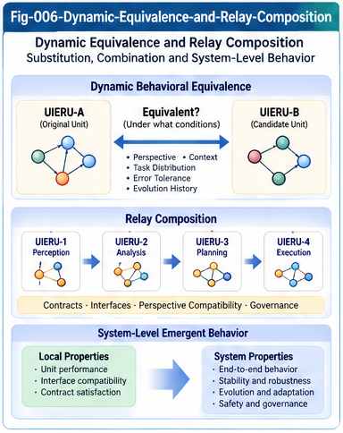

# BUI-005 — Dynamic Equivalence, Relay Composition, and Emergent Relations

**Project:** Beyond UIERU: Dynamic Structural Intelligence and Open Research Relay (BUI-DSI)  
**Version:** 1.0.0 — Research proposal  
**Authors:** Sizhe Tan & GPT-Obot  
**Status:** Open research agenda; definitions and propositions are provisional

## Abstract

Universal Intelligence Evolution and Relay Units (UIERUs) invite a shift from comparing static capabilities to comparing context-dependent behavior, histories, and interactions. This paper develops a provisional framework for *dynamic equivalence*, *relay composition*, and *emergent relations*. It distinguishes observational similarity from substitutability, defines a contract-relative behavioral distance, and studies when properties of individual units can survive composition. It further proposes a dynamic intelligence relationship graph whose edges depend on perspective, context, time, and interaction history. Rather than claiming general theorems for arbitrary evolving systems, the paper supplies explicit assumptions, counterexamples, testable hypotheses, and a research-relay interface for mathematics, formal methods, neuroscience, and engineering.

**Keywords:** UIERU; dynamic structural intelligence; behavioral equivalence; approximate bisimulation; relay composition; contextual equivalence; contract preservation; emergence; structural evolution; counter-evidence.

---



---

## 1. Motivation: Beyond Static Unit Matching

Traditional capability matching asks whether a unit exposes a required function or contract. Dynamic structural intelligence asks a harder question: whether a unit will behave acceptably under a specified perspective, environment, task distribution, and history—and whether replacing or combining it with another unit changes system behavior.

A UIERU may contain a relatively stable structural core and dynamic evaluation, selection, feedback, and evolution mechanisms. Identical interfaces do not imply identical decisions. Identical decisions on one test set do not imply identical trajectories. Similar trajectories do not guarantee safe substitution in a larger relay network.

This paper therefore separates four notions:

1. **Structural compatibility:** the units expose compatible interfaces and types.
2. **Behavioral similarity:** the units generate similar observations under specified conditions.
3. **Contextual substitutability:** replacement preserves a specified external contract within a declared operating domain.
4. **Evolutionary compatibility:** acceptable behavior remains valid under specified future updates and interactions.

The distinctions are necessary for honest localization, comparison, and composition.

## 2. Research Lineage and Scope

The proposed work builds on the SI research progression from differential structures and context-bound localization to portable intelligence pieces, scoring forests, universal control planes, the Structural Intelligence Framework (SIF), and UIERU. BUI-002 introduces perspective masking and observation contracts; BUI-003 introduces perspective differential trees; BUI-004 introduces perspective-aware structural queries (PASQ). This paper addresses the next question: what can comparisons justify about substitution, relay, and collective behavior?

The framework is deliberately independent of any particular LLM, ANN, database, or neural implementation. It is not a claim that UIERUs are fundamental biological units or that their emergent behavior has been empirically demonstrated.

## 3. A Minimal Dynamic Unit Model

Represent a unit as a labeled, probabilistic transition system with optional structural evolution:

$$
U=(X,A,O,P,C,\Theta,T,G,\mathsf{obs},\mathcal K).
$$

Here:

- \(X\) is the internal state space, including relevant history summaries;
- \(A\) is the action space;
- \(O\) is the observable output space;
- \(P\) is the perspective space;
- \(C\) is the context/environment specification space;
- \(\Theta\) is the set of mutable structural and scoring parameters;
- \(T(x',o\mid x,a,p,c,\theta)\) is a transition-and-observation kernel;
- \(G(\theta'\mid\theta,x,a,o,p,c)\) describes permitted evolution;
- \(\mathsf{obs}\) projects internal runs to an observer's allowed view;
- \(\mathcal K\) is the declared contract set.

The model is an abstraction: some implementations will use deterministic transitions, non-Markovian history, changing action alphabets, or dynamically created components. In those cases the state and interface model must be extended, not silently assumed fixed.

A **comparison domain** is

$$
D=(\mathcal P,\mathcal C,\mathcal H,\mathcal E,\mathcal M,\tau),
$$

specifying allowed perspectives, contexts, initial histories, environments, masking/observation policy, and observation horizon. A comparison claim without \(D\) is underspecified.

## 4. Four Levels of Dynamic Equivalence

### 4.1 Interface or structural equivalence

Two units are structurally compatible when their typed input/output interfaces and declared preconditions can be related by a valid adapter. This is a necessary condition for many substitutions, but not sufficient.

### 4.2 Output equivalence

For a fixed domain \(D\), units are output-equivalent if their observable output distributions agree for all admissible test conditions. Empirical finite-sample agreement supports only an estimate, not universal equivalence.

### 4.3 Trajectory equivalence

Trajectory equivalence compares sequences of observations, decisions, and possibly costs over a horizon \(\tau\). It can distinguish units that make the same immediate choice but behave differently after feedback.

### 4.4 Contextual equivalence

Two units are contextually equivalent relative to a family of permitted relay environments \(\mathfrak E\) and contract predicates \(\mathcal K\) if no admissible environment distinguishes them on the contract-relevant observations. This is substantially stronger than equality on a benchmark dataset.

**Key principle:** every equivalence statement is relative to an observation policy and domain; no single equivalence relation automatically serves all applications.

## 5. Approximate Behavioral Distance

For an explicitly selected observable trajectory metric \(d_{\mathrm{tr}}\), define a candidate distance

$$
 d_D(U,V)=\sup_{z\in D}\; \mathsf{Dist}\bigl(\mathcal L(\mathsf{obs}(\mathrm{Run}(U,z))),\mathcal L(\mathsf{obs}(\mathrm{Run}(V,z)))\bigr),
$$

where \(z\) is an admissible test configuration, \(\mathcal L\) denotes a trajectory distribution, and \(\mathsf{Dist}\) is a chosen distributional metric (for example, total variation or a Wasserstein metric when its assumptions hold).

We may write

$$
U\approx_{D,\epsilon}V \quad\Longleftrightarrow\quad d_D(U,V)\le\epsilon.
$$

This **tolerance relation need not be transitive**: \(d(U,V)\le\epsilon\) and \(d(V,W)\le\epsilon\) imply at most \(d(U,W)\le2\epsilon\) under a triangle inequality. Therefore an \(\epsilon\)-similarity group must not automatically be called an equivalence class. Exact zero-distance classes, when the metric assumptions support them, are a different object.

Practical measurements should report coverage, confidence intervals, shift sensitivity, and uncertainty due to unobserved histories.

## 6. Bisimulation and Its Limits

Bisimulation from transition-system theory is a promising starting point: related states must match observations and preserve a relation through future transitions. Probabilistic and approximate bisimulation variants can help formalize UIERU behavior.

However, direct reuse is not automatic. UIERUs may change their transition kernels, interface sets, and scoring structures. A viable research program must decide whether evolution is:

- included as an explicit transition label;
- represented by an augmented state containing structural parameters;
- bounded by an admissible-update contract; or
- treated as a reason to invalidate and re-establish equivalence.

A central open question is whether a useful **evolution-aware approximate bisimulation** can remain computationally tractable while preserving meaningful guarantees.

## 7. Relay Composition as a Typed Operation

Let

$$
U_A\otimes_R U_B
$$

represent a composition under relay protocol \(R\). The operator is *partial*: composition is defined only when required types, capabilities, permissions, timing constraints, and environmental assumptions are compatible.

The resulting system may include new state (message queues, shared memory, retries), new actions (delegation, cancellation), and new failure modes (deadlocks, amplification, feedback loops). It is not generally the simple sum of the component units.

A relay contract should specify:

1. input/output schemas and semantic mappings;
2. ownership and authority boundaries;
3. delivery, ordering, retry, and timeout semantics;
4. observability and evidence provenance;
5. allowed adaptation and version changes;
6. failure containment and rollback conditions.

## 8. Contract Preservation Under Composition

A tempting but generally invalid inference is

$$
\mathcal K(U_A)\land\mathcal K(U_B)\;\Rightarrow\;\mathcal K(U_A\otimes_R U_B).
$$

**Counterexample:** two individually safe units each retry failed messages indefinitely. A cyclic relay can create unbounded traffic despite each unit satisfying its local retry rule.

A more defensible conditional research proposition is:

> If components satisfy compatible assume-guarantee contracts, relay semantics satisfy the interface assumptions, and all relevant interference and update behaviors are covered, then a specified global property may be derivable from local properties.

This is a research schema, not a universal theorem. The property (safety, liveness, latency, cost, privacy, or correctness) must be identified, and proof obligations vary accordingly.

## 9. Substitution Is Context- and Contract-Relative

Suppose \(U_A\) is replaced by \(U_B\) in environment \(E\). Substitution is justified only if

$$
\mathcal K\bigl(E[U_A]\bigr)\;\Longrightarrow\;\mathcal K\bigl(E[U_B]\bigr)
$$

holds for the declared contract and operating domain, or if the resulting degradation is explicitly bounded and accepted.

A useful engineering substitution check comprises:

- interface and permission compatibility;
- matched comparison conditions;
- behavior and trajectory tests;
- stress tests under distribution shift;
- relay-specific failure tests;
- evolution/version drift monitoring;
- explicit rollback criteria.

Similarity is evidence for substitution, never a blanket license to substitute.

## 10. Emergent Dynamic Relationships

The next research granularity may be a relationship rather than a larger unit. Define a dynamic relation

$$
R_{ij}(t,p,c,h;E)
$$

between units \(U_i\) and \(U_j\), conditional on time, perspective, context, interaction history, and relay environment. Relations may include delegation, dependence, competition, complementarity, substitution, shared learning, and evaluation authority.

Represent a population as a time-varying, typed, attributed multigraph:

$$
\mathcal G_t=(\mathcal U_t,\mathcal R_t,\mathcal A_t),
$$

where nodes are evolving units, edges are observed or proposed relations, and attributes record contracts, evidence, confidence, and validity intervals.

A relation is not necessarily stable or symmetric. For example, \(U_A\) can substitute for \(U_B\) under a low-latency perspective while the reverse fails under a high-accuracy perspective.

## 11. What Counts as Emergence?

The term *emergence* should not mean merely that a composed system is complicated. A candidate emergent property should be operationalized as a measurable system-level behavior that cannot be predicted adequately from a specified baseline model of isolated components without accounting for their interactions.

Examples worth testing include:

- improved task coverage through complementary capabilities;
- new coordination failures caused by relay feedback;
- collective adaptation absent from isolated trials;
- stable division of labor under shifting perspectives.

For each claim, report the baseline, interaction mechanism, measured effect, and alternative explanations. Emergence is an empirical and modeling claim, not an automatic consequence of composition.

## 12. Dynamic Differential Trees for Relationship Analysis

Perspective Differential Trees (BUI-003) can index not only unit-level score and decision changes but also **relation differentials**:

- a relay edge appears or disappears;
- delegation direction reverses;
- substitution validity changes;
- a contract becomes violated after an update;
- collective outcomes diverge under two perspectives.

A relationship-differential record should include unit versions, comparison domain, mask policy, observed trajectory, edge type, causal status (observed versus hypothesized), and counter-evidence.

This supports queries such as: *Which relay relationships remain contract-valid after a perspective change?* and *Which combinations exhibit the largest outcome shifts after structural evolution?*

## 13. Perspective-Aware Queries Over Composition

PASQ (BUI-004) provides a possible operational interface. A conceptual relational schema includes:

```sql
CREATE TABLE relay_observations (
    observation_id TEXT PRIMARY KEY,
    source_unit_id TEXT NOT NULL,
    target_unit_id TEXT NOT NULL,
    source_version TEXT NOT NULL,
    target_version TEXT NOT NULL,
    perspective_id TEXT NOT NULL,
    context_id TEXT NOT NULL,
    relay_contract_id TEXT NOT NULL,
    observed_at TIMESTAMP NOT NULL,
    relation_type TEXT NOT NULL,
    outcome_status TEXT NOT NULL,
    evidence_ref TEXT NOT NULL
);
```

An example query for observed violations is:

```sql
SELECT source_unit_id, target_unit_id, relay_contract_id,
       COUNT(*) AS observed_violations
FROM relay_observations
WHERE outcome_status = 'contract_violation'
GROUP BY source_unit_id, target_unit_id, relay_contract_id;
```

Such a query reports recorded events only. It does not establish causal responsibility, global equivalence, or future reliability. Those claims require experimental design or formal reasoning.

## 14. Evolution, Identity, and Versioned Equivalence

If \(U_t\) evolves to \(U_{t+1}\), a previously established similarity relation may no longer hold. The framework therefore requires:

- versioned unit identities and contracts;
- explicit update events and structural provenance;
- comparison validity windows;
- revalidation triggers after relevant changes;
- historical continuity criteria distinguished from behavioral equivalence.

A unit may preserve its identity while changing behavior; conversely, two distinct units may temporarily behave alike. **Identity and equivalence are separate questions.** This distinction also connects to Subjective Structural Intelligence (SSI), where subject boundaries and historical identity matter.

## 15. Mathematical Research Interfaces

Several established fields offer useful tools, subject to careful mapping:

| Field | Candidate contribution | Principal caveat |
|---|---|---|
| Labeled/probabilistic transition systems | Trace semantics and bisimulation | Evolving state spaces |
| Metric geometry and optimal transport | Quantitative behavioral distance | Choice of metric and domain |
| Formal methods / assume-guarantee reasoning | Contract-preserving relay | Interference and hidden assumptions |
| Category theory / compositional semantics | Typed composition and abstraction | Must produce operationally useful semantics |
| Dynamic graphs and network science | Time-varying intelligence relations | Correlation versus causation |
| Game theory / multi-agent learning | Strategic and adaptive interaction | Nonstationarity and incentives |
| Control theory | Feedback stability and robustness | Model mismatch and partial observation |

This paper does not claim these connections are novel in isolation. Novelty, if any, must be established by comparison with the relevant literature and by demonstrating useful UIERU-specific formulations.

## 16. Biological Intelligence: A Cautious Connection

Biological neural systems exhibit context-dependent action selection, recurrent coordination, learning, and flexible network participation. These phenomena motivate research on dynamic functional organizations. However, no direct anatomical correspondence to a UIERU, relay contract, or scoring forest is assumed.

One productive hypothesis is that task-dependent functional groupings may provide a biological analogy for dynamically constituted intelligence relationships. Testing it requires independently specified neural measurements, behavioral tasks, and competing models—not merely diagrammatic similarity.

## 17. Counterexamples and Failure Modes

**CE-1: Benchmark coincidence.** Two units agree on a small benchmark but diverge under rare contexts. *Lesson:* sample agreement is not universal equivalence.

**CE-2: Nontransitive tolerance.** A is within tolerance of B and B of C, but A is not within tolerance of C. *Lesson:* approximate similarity need not form equivalence classes.

**CE-3: Unsafe substitution.** An alternative unit produces the same answer but violates a privacy or latency contract. *Lesson:* output equality is insufficient.

**CE-4: Composition feedback.** Individually bounded retry mechanisms create a global retry storm. *Lesson:* local guarantees require relay assumptions.

**CE-5: Evolution invalidation.** A learning update changes scoring priorities and breaks an earlier substitution guarantee. *Lesson:* comparisons must be versioned and monitored.

**CE-6: Mask-induced artifact.** Masking a perspective removes a constraint that would have prevented a decision. *Lesson:* observational filtering and execution intervention must not be conflated.

These counterexamples should be included in adversarial validation rather than treated as exceptions to be ignored.

## 18. Testable Hypotheses

**H1 — Conditioned equivalence improves substitution reliability.** Substitution based on context- and contract-relative trajectory evidence will show fewer contract violations than substitution based on static interface matching alone, under a pre-registered test distribution.

**H2 — Relationship differentials improve localization.** Indexing changes in relay relationships will improve retrieval of compatible unit compositions compared with unit-only descriptors at matched indexing cost.

**H3 — Version-aware validation reduces silent failures.** Revalidating equivalence after relevant evolution events will reduce undetected substitution failures relative to a fixed initial certification.

**H4 — Explicit relay contracts improve compositional predictability.** Assume-guarantee contracts with specified timing and retry semantics will predict more observed system-level properties than untyped relay links.

**H5 — Emergence claims depend on baselines.** Some apparent collective gains will disappear when compared with strong non-interacting or centrally orchestrated baselines; others may persist and identify genuinely useful interaction mechanisms.

Each hypothesis requires defined metrics, baselines, sample sizes, and reporting of negative results.

## 19. Validation Roadmap

**Phase A — Minimal models.** Implement small deterministic and stochastic units with explicit perspectives, state transitions, and versioned contracts. Prove elementary properties or construct counterexamples.

**Phase B — Differential observation.** Use BUI-002 masking contracts and BUI-003 differential trees to compare score, decision, trajectory, and relation changes.

**Phase C — Relay substitution.** Compare interface-only matching, behavioral matching, and contract-relative substitution under controlled perturbations.

**Phase D — Evolution stress tests.** Introduce scoring updates, new capabilities, and changing contexts. Measure validity decay and revalidation overhead.

**Phase E — Open relay.** Publish reproducible datasets, proof obligations, failed conjectures, query schemas, and alternative models for independent researchers.

The first version of this repository may remain a research proposal without claiming completion of these phases.

## 20. Research Relay Questions

1. What is the weakest practically useful notion of dynamic equivalence for safe substitution?
2. Which approximate behavioral distances admit efficient estimation with partial observability?
3. Under what restrictions is relay composition associative, and what does associativity mean for stateful systems?
4. Which safety or liveness properties are compositional under adaptive learning?
5. Can relationship-level differential indexes outperform unit-level localization without excessive overhead?
6. How should an evolving unit's identity be separated from its behavior and contract versions?
7. Can a meaningful theory of dynamic functional-unit boundaries be tested against biological neural data?
8. How can counter-evidence invalidate or refine previously accepted equivalence claims?

Each question can become an independently citable and extendable Research Relay Piece.

## 21. Suggested Research Relay Contract

A portable research contribution should state:

```yaml
research_piece:
  problem_id: BUI-005
  scope: dynamic-equivalence-and-relay-composition
  model_version: proposed-v1
  comparison_domain: explicit
  observation_policy: explicit
  assumptions: []
  claim_type: conjecture-or-proof-or-experiment
  evidence_refs: []
  counter_evidence_refs: []
  validation_protocol_ref: pending
  interface_contract_refs: []
  provenance: required
  limitations: []
```

This schema is illustrative, not a ratified standard. It is intended to lower the barrier for mathematical, engineering, and neuroscience contributions.

## 22. Conclusions

The transition from static SI objects to dynamic UIERUs changes the meaning of matching, equivalence, and composition. A usable theory must account for perspective, context, history, observation, contracts, and evolution. It must distinguish *similarity* from *substitutability*, and *local properties* from *system-level guarantees*. Dynamic intelligence relationships may become an important research granularity beyond the individual UIERU.

The immediate contribution of BUI-005 is a structured, falsifiable research agenda—not a completed universal theory. By making assumptions, counterexamples, and relay interfaces explicit, it aims to turn an emerging SI research horizon into work that other researchers can independently challenge and extend.

## References and Related Foundations

The following established research areas provide starting points for literature review; inclusion does not imply that the present framework has been formally derived from them.

1. Milner, R. *Communication and Concurrency*. Prentice Hall, 1989. (Behavioral equivalence and process calculi.)
2. Larsen, K. G., and Skou, A. “Bisimulation through Probabilistic Testing.” *Information and Computation*, 94(1), 1991, 1–28.
3. Alur, R., Henzinger, T. A., and Kupferman, O. “Alternating-Time Temporal Logic.” *Journal of the ACM*, 49(5), 2002, 672–713. (Strategic temporal properties.)
4. de Alfaro, L., and Henzinger, T. A. “Interface Automata.” *Proceedings of ESEC/FSE*, 2001. (Component compatibility.)
5. Baier, C., and Katoen, J.-P. *Principles of Model Checking*. MIT Press, 2008.
6. SIF, UIERU, BUI-002, BUI-003, and BUI-004: companion SI research artifacts; insert version-specific repository/DOI references once releases are registered.

## Citation and Status Note

**Authors:** Sizhe Tan & GPT-Obot.  
**Project:** Beyond UIERU: Dynamic Structural Intelligence and Open Research Relay.  
**Document:** BUI-005 — Dynamic Equivalence, Relay Composition, and Emergent Relations.  
**Status:** v1.0.0 open research proposal.  

This work distinguishes definitions, candidate hypotheses, illustrative examples, and established external theories. It welcomes independent proofs, counterexamples, experiments, and alternative formalizations.
