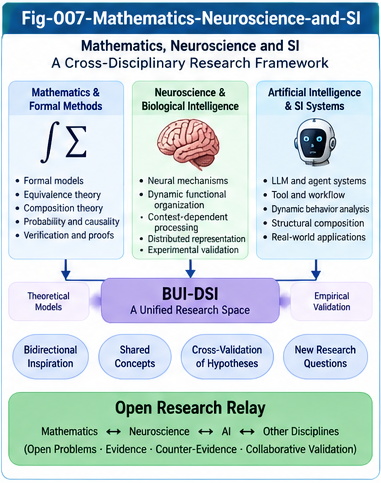

# BUI-006 — Mathematical Foundations and Open Formal Problems

**Project:** Beyond UIERU: Dynamic Structural Intelligence and Open Research Relay (BUI-DSI)  
**Version:** 1.0.0 — Research proposal  
**Authors:** Sizhe Tan & GPT-Obot  
**Status:** Open research agenda; definitions and conjectures are provisional

## Abstract

Dynamic intelligence units challenge structural-intelligence methods originally developed for relatively stable objects. Their observable behavior depends on perspective, context, internal state, interaction, and evolving structure. This paper proposes a minimal mathematical vocabulary for such units and identifies tractable formal problems in masking, behavioral equivalence, differential localization, relay composition, and open structural evolution. It separates observational projections from interventions, exact equivalence from approximate similarity, and empirical evidence from proof. The objective is not to claim a new completed theory, but to publish portable, falsifiable problems that mathematicians, theoretical computer scientists, control researchers, database theorists, and engineers can independently refine and relay.

**Keywords:** dynamic structural intelligence; UIERU; perspective masking; transition systems; bisimulation; compositional verification; provenance; temporal query; open evolution; research relay

---



---

## 1. Motivation and scope

Earlier SI work—including MDT, CCC, UTN, portable intelligence pieces, scoring forests, SIF localization, and UIERU—motivates a shift from describing structures to comparing *stateful, interacting, evolving* intelligence units. This paper asks which properties of a unit remain observable, comparable, or provable when perspectives, histories, and compositions change.

The proposed constructs are research abstractions. They are not claims that biological brains implement a literal UIERU, nor that the mathematical problems below are novel relative to all existing literature. A systematic prior-art review is required before asserting novelty.

## 2. A minimal typed dynamic-unit model

Let a dynamic intelligence unit be a tuple

\[
U=(X,A,Y,P,C,\Theta,\mathsf{step},\mathsf{observe},\mathsf{update},K).
\]

Here:

- \(X\): internal states, including relevant history summaries;
- \(A\): admissible actions and relay operations;
- \(Y\): observable outputs and evidence records;
- \(P\): perspectives (valuation or selection conditions);
- \(C\): contexts, including environment and task descriptors;
- \(\Theta\): structural configurations, potentially containing scoring forests and contracts;
- \(\mathsf{step}:X\times\Theta\times P\times C\times A\to\mathcal D(X\times Y)\): possibly stochastic execution kernel;
- \(\mathsf{observe}\): an explicitly typed observation function;
- \(\mathsf{update}\): a rule that may revise state, parameters, or structure;
- \(K\): interface and safety contracts.

\(\mathcal D\) denotes a probability distribution when stochastic behavior is modeled; a deterministic system is a special case. This tuple is a *modeling choice*, not a canonical definition of UIERU. For changing state spaces, embed configurations in a disjoint union \(\bigsqcup_{\theta\in\Theta}X_\theta\), or use a typed transition system indexed by configuration.

A trace of horizon \(T\) is \(\tau=(x_0,a_0,y_1,x_1,\ldots,a_{T-1},y_T,x_T)\). Every comparison must declare the controlled inputs, context, perspective, observation policy, and horizon.

## 3. Three distinct meanings of masking

### 3.1 Observational projection

An observational mask \(M:Y\to Z\) maps a complete observation to a restricted view. It does not alter the transition kernel. For trace observations, define \(M_*\) pointwise or through an explicitly declared aggregation.

### 3.2 Execution intervention

An intervention \(I\) changes a parameter, policy, scoring operator, or admissible action and thereby changes the transition kernel to \(\mathsf{step}^{I}\). An intervention is **not** interchangeable with observational projection.

### 3.3 Counterfactual reconstruction

A counterfactual estimator \(\widehat{\mathsf{CF}}(U,I,e)\) estimates what might have happened under intervention \(I\) from evidence \(e\). Its result is model-dependent and requires uncertainty reporting and identification assumptions. It is neither an observation nor an automatically valid causal conclusion.

## 4. Open Problem M1 — A masking algebra

For pure projections defined as field restrictions \(M_S\) onto sets of observable fields \(S\), suitable typed composition can satisfy

\[
M_S\circ M_T=M_{S\cap T},\qquad M_S\circ M_S=M_S.
\]

These identities require a common underlying record space and consistent semantics. They should not be generalized to execution interventions, learned imputations, or aggregations without proof.

**Questions:** Which masks commute? When does a mask preserve a property \(\varphi\)? Can masks form a lattice of observational information? Can one quantify the information discarded by a mask?

**Candidate preservation statement:** For an observation-only mask \(M\), a property \(\varphi\) is preserved if it factors through \(M\): there exists \(\psi\) with \(\varphi=\psi\circ M\). This is a sufficient structural criterion, not a guarantee for arbitrary properties.

**Counterexample target:** Hide a variable that changes action selection while retaining a visible score. Show that apparent decision equivalence under the mask does not imply full behavioral equivalence.

## 5. Open Problem E1 — Behavioral equivalence under perspective

For fixed \(p\in P\), \(c\in C\), and horizon \(T\), let \(\mathsf{Law}_T(U;p,c)\) denote the distribution of observable traces under a declared action-input protocol.

Define an observational pseudodistance

\[
d_T(U,V\mid p,c,M)=D\big(M_*\mathsf{Law}_T(U;p,c),M_*\mathsf{Law}_T(V;p,c)\big),
\]

where \(D\) is a stated probability-distribution distance, such as total variation where applicable. This can be zero for behaviorally distinct systems when the mask discards relevant information.

For a domain \(\Omega\subseteq P\times C\), a conditional approximate equivalence criterion is

\[
U\approx_{\Omega,T,\varepsilon,M}V
\quad\Longleftrightarrow\quad
\sup_{(p,c)\in\Omega}d_T(U,V\mid p,c,M)\le\varepsilon.
\]

**Important:** Threshold-based approximate equivalence need not be transitive; therefore it is generally not an equivalence relation or a valid quotient partition. Exact zero-distance equivalence may be an equivalence relation under appropriate assumptions. For substitution in arbitrary environments, stronger contextual equivalence or (probabilistic) bisimulation conditions may be required.

**Questions:** When do finite-horizon bounds extend to longer horizons? Can approximate bisimulation metrics bound substitution error? What evidence is sufficient to support a claimed tolerance under distribution shift?

## 6. Open Problem D1 — Differential trees as conditional indexes

Define a comparison contract

\[
\Gamma=(\Omega,T,M,\Pi,\Sigma,E),
\]

where \(\Pi\) fixes input/action protocols, \(\Sigma\) specifies score calibration, and \(E\) records evidence and provenance.

A perspective differential record may contain

\[
\Delta_\Gamma(U;p_1,p_2)=(\Delta_s,\Delta_a,\Delta_\tau,\Delta_\theta),
\]

representing scoring, decision, trajectory, and structural-update differences. Components may be undefined when calibration or alignment fails; missingness must not be silently replaced with zero.

A Perspective Differential Tree (PDT) is proposed as an *index* over such conditional records, not as a proof that observed differences are causally attributable to perspective.

**Questions:** Which index decompositions are lossless for a query class? How can a query planner preserve comparison-contract constraints? Can upper/lower bounds prune search without excluding valid results?

## 7. Open Problem Q1 — Perspective-aware query semantics

A query result should be modeled as a pair \((r,\rho)\), where \(r\) is a result and \(\rho\) records provenance, comparison conditions, and uncertainty. For a query operator \(Q\), ask whether

\[
Q(M(D))\stackrel{?}{=}M'(Q(D))
\]

for a compatible output mask \(M'\). The equality holds only under explicit query and mask restrictions; aggregation, joins, and predicates on hidden fields can break it.

**Research tasks:** Define typed perspective predicates; specify temporal snapshot semantics; distinguish observed outcomes from simulated counterfactuals; test provenance-preserving joins; and evaluate query-plan correctness.

## 8. Open Problem R1 — Relay composition and contracts

Let \(U\otimes_R V\) be a partial composition operator, defined only when interface types and relay protocol \(R\) are compatible. It may not be associative: relay order, state sharing, and scheduling can change outcomes.

Let \(A_U\Rightarrow G_U\) and \(A_V\Rightarrow G_V\) be assume-guarantee contracts. A composition theorem requires explicit compatibility assumptions—for example, each component's guarantees establish the other's assumptions, the relay protocol preserves required invariants, and the environment satisfies the remaining assumptions.

**Questions:** Under what conditions is relay composition associative up to behavioral equivalence? Which safety properties are compositional? How should shared resources, feedback loops, and learning updates be represented?

**Counterexample target:** Two individually safe agents that deadlock when composed because each waits for the other's acknowledgment.

## 9. Open Problem G1 — Open structural evolution

Let structural evolution be \(\theta_{t+1}=G(\theta_t,x_t,e_t)\), where \(e_t\) includes evidence and counter-evidence. Growth may change the available state space, action vocabulary, or contracts.

**Questions:** What does identity preservation mean across changes in \(\theta\)? Which invariants can survive model-class expansion? Can local validation certificates be reused after structural updates? How should uncertainty accumulate across a chain of relays and revisions?

A practical target is *versioned conditional assurance*: every claim records the configuration range, environment assumptions, evidence, and validity interval for which it is supported.

## 10. Open Problem B1 — Biological relevance without structural overclaim

Biological nervous systems exhibit context-sensitive valuation, distributed computation, plasticity, and dynamically coordinated activity. These motivate comparisons with UIERU-like functional organization, but do not establish literal scoring trees, fixed unit boundaries, or explicit relay contracts in brains.

**Questions:** Can a minimal dynamic-unit model predict task switching, context-dependent choice, or flexible coalition formation? Which observations distinguish the model from simpler recurrent-network or reinforcement-learning alternatives? What experiments could falsify the proposed analogy?

The biological research program should favor measurable predictions over metaphorical correspondence.

## 11. Candidate mathematical toolkits

| Toolkit | Candidate use | Main limitation |
| --- | --- | --- |
| Labeled/probabilistic transition systems | Dynamic-unit semantics | State explosion; evolving types |
| Bisimulation and behavioral metrics | Contextual similarity and substitution | Strong assumptions for compositionality |
| Abstract interpretation | Sound masked views and property preservation | Abstraction may be coarse |
| Relational algebra and provenance semirings | Perspective-aware structural query | Counterfactuals require additional semantics |
| Assume-guarantee reasoning | Relay contract composition | Circular dependencies and learning updates |
| Control and hybrid-systems theory | Stability and feedback | Nonstationary open-ended structure |
| Causal inference | Intervention versus observation | Identification and confounding |
| Category-theoretic composition | Typed interfaces and compositional laws | Must yield testable concrete results |

These are candidate connections, not novelty claims. Any formal research contribution must compare against existing results in the corresponding field.

## 12. Five falsifiable hypotheses

**H1 — Mask efficiency.** Typed observational masks reduce localization cost while preserving answers to a declared query subset. *Falsifier:* unacceptable false negatives or provenance loss on that subset.

**H2 — Differential utility.** PDT indexing improves retrieval or explanation of perspective-sensitive changes relative to a matched baseline. *Falsifier:* no benefit under controlled workloads.

**H3 — Conditional substitution.** Bounded behavioral distance predicts substitution performance within a specified context family. *Falsifier:* systematic contract violations despite satisfied measured bounds.

**H4 — Relay assurance.** Explicit assume-guarantee contracts reduce integration failures compared with interface-type checks alone. *Falsifier:* no measurable reduction on representative compositions.

**H5 — Biological discriminability.** A dynamic-unit hypothesis predicts context-dependent behavior not explained equally well by a simpler baseline. *Falsifier:* equal or superior baseline predictive fit under comparable complexity and data.

## 13. Minimal validation program

1. **Formal baseline:** implement a small finite-state UIERU-like model with two perspectives and explicit observation masks.
2. **Proof obligations:** verify projection identities; demonstrate counterexamples for intervention commutativity and approximate-equivalence transitivity.
3. **Differential indexing:** compare PDT retrieval against a full scan under identical comparison contracts.
4. **Relay experiments:** test safe composition, incompatible contracts, deadlocks, and stateful feedback.
5. **Evolution experiments:** change scoring structures between trials; track identity, versioning, and invalidated guarantees.
6. **Biological model comparison:** only where suitable public experimental data and domain expertise are available; predefine predictions and baselines.

Report negative results, invalid assumptions, and model failures as first-class outcomes.

## 14. Research relay interface

Each independent contribution should declare:

```yaml
relay_piece:
  id: "RELAY-EXAMPLE"
  problem: "Precise question"
  model_version: "0.1"
  assumptions: []
  definitions: []
  proposed_claims: []
  proofs_or_counterexamples: []
  empirical_evidence: []
  validity_scope: []
  known_limitations: []
  related_work: []
  provenance: []
  next_questions: []
```

A contribution may consist of a theorem, a counterexample, a corrected definition, an empirical failure, or a reusable benchmark. No result should be represented as established without its supporting proof or evidence.

## 15. Interdisciplinary participation

- **Mathematics and theoretical computer science:** semantics, equivalence, algebra, composition, proof.
- **Database theory:** query correctness, differential indexing, provenance, temporal and contextual data.
- **Control and multi-agent systems:** feedback stability, policy interactions, emergent behavior.
- **Computational neuroscience:** functional hypotheses, alternative models, empirical discrimination.
- **SI/MET engineering:** executable examples, interface specifications, benchmarks, reproducibility.

The most effective invitation is a small, precisely stated problem that stands on its own, not a requirement to endorse the full SI research program.

## 16. Relationship to the BUI-DSI series

- **BUI-001:** motivation for the transition from static structures to dynamic units.
- **BUI-002:** perspective masking and observational semantics.
- **BUI-003:** differential trees and dynamic localization.
- **BUI-004:** perspective-aware structural query and SQL.
- **BUI-005:** dynamic equivalence, relay composition, emergent relations.
- **BUI-006 (this paper):** mathematical problem statements and validation obligations.
- **BUI-007:** biological intelligence and dynamic organizational biomimicry.
- **BUI-008:** open research relay and the next research horizon.

## 17. Related foundations and reading anchors

The following are established starting points for literature comparison, not claims of direct derivation or comprehensive coverage:

1. Park, D. (1981). *Concurrency and Automata on Infinite Sequences*. In Theoretical Computer Science, LNCS 104. (Bisimulation foundations.)
2. Milner, R. (1989). *Communication and Concurrency*. Prentice Hall. (Process semantics and behavioral equivalence.)
3. Cousot, P., & Cousot, R. (1977). *Abstract Interpretation: A Unified Lattice Model for Static Analysis of Programs by Construction or Approximation of Fixpoints*. POPL. (Sound abstraction.)
4. Larsen, K. G., & Skou, A. (1991). *Bisimulation Through Probabilistic Testing*. Information and Computation. (Probabilistic behavioral equivalence.)
5. de Alfaro, L., & Henzinger, T. A. (2001). *Interface Automata*. ESEC/FSE. (Compositional interface reasoning.)
6. McCarthy, J. (1963). *A Basis for a Mathematical Theory of Computation*. In Computer Programming and Formal Systems. (Formal computational reasoning.)
7. Green, T. J., Karvounarakis, G., & Tannen, V. (2007). *Provenance Semirings*. PODS. (Database provenance.)
8. Sutton, R. S., & Barto, A. G. (2018). *Reinforcement Learning: An Introduction*, 2nd ed. MIT Press. (Sequential decision and learning models.)

A release-ready literature review should verify bibliographic metadata, add recent work on approximate probabilistic bisimulation and compositional learning systems, and document overlaps before any priority or originality claims.

## 18. Limitations and research integrity

The framework does not yet provide a universal metric of intelligence, a complete UIERU operational semantics, a general theorem of relay safety, or evidence of a one-to-one neural implementation. The proposed mathematical structures can fail under partial observability, nonstationarity, heterogeneous ontologies, adversarial adaptation, or uncontrolled changes of context. All claims should remain conditional and versioned.

## 19. Conclusion

The next step after dynamic intelligence units is not necessarily a larger unit. It may be a rigorous language for observing, comparing, querying, composing, and revising evolving units and their relationships. Perspective masking, conditional differential localization, behavioral metrics, relay contracts, and open structural evolution offer a tractable initial agenda. This paper publishes those problems as an open research relay: precise enough to challenge, modular enough to extend, and deliberately incomplete enough to invite independent mathematical and empirical work.

> **The purpose is not to declare dynamic structural intelligence solved, but to make its formal problems visible, testable, and openly relayable.**

---

**Citation guidance:** Cite the BUI-DSI repository and version-specific DOI once assigned. No DOI is asserted in this draft.  
**Authors:** Sizhe Tan & GPT-Obot  
**License:** Subject to repository-level license and attribution metadata.
